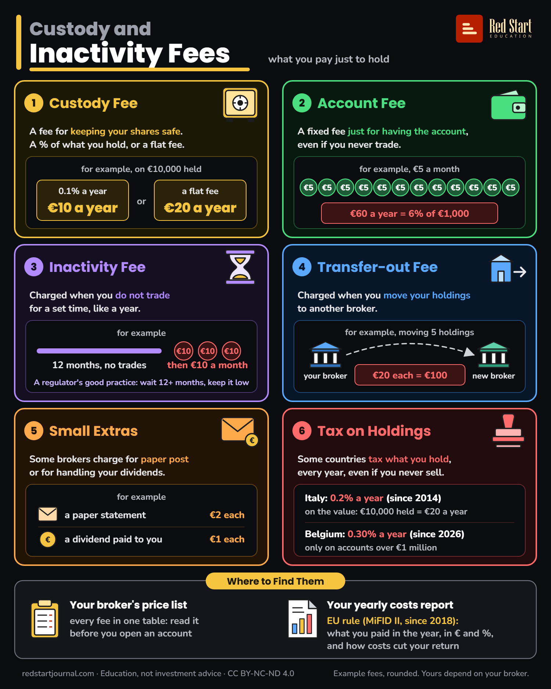

# Custody and Inactivity Fees

Six costs of just holding investments: custody, account, inactivity, transfer-out, small extras and taxes on holdings.

## What the sheet says

Custody and Inactivity Fees. What you pay just to hold.

1. Custody Fee. A fee for keeping your shares safe. A % of what you hold, or a flat fee. For example, on €10,000 held: 0.1% a year is €10 a year, or a flat fee of €20 a year.

2. Account Fee. A fixed fee just for having the account, even if you never trade. For example, €5 a month: €60 a year, which is 6% of €1,000.

3. Inactivity Fee. Charged when you do not trade for a set time, like a year. For example: 12 months with no trades, then €10 a month. A regulator's good practice: wait 12 or more months, and keep the fee low.

4. Transfer-out Fee. Charged when you move your holdings to another broker. For example, moving 5 holdings from your broker to a new broker: €20 each, so €100.

5. Small Extras. Some brokers charge for paper post or for handling your dividends. For example: a paper statement, €2 each; a dividend paid to you, €1 each.

6. Tax on Holdings. Some countries tax what you hold, every year, even if you never sell. Italy: 0.2% a year (since 2014), on the value: €10,000 held means €20 a year. Belgium: 0.30% a year (since 2026), only on accounts over €1 million.

Where to Find Them. Your broker's price list: every fee in one table. Read it before you open an account. Your yearly costs report: an EU rule (MiFID II, since 2018). It shows what you paid in the year, in € and in %, and how costs cut your return.

Example fees, rounded. Yours depend on your broker. redstartjournal.com · Education, not investment advice · CC BY-NC-ND 4.0

## Sources

1. [Commission Delegated Regulation (EU) 2017/565, Article 50](https://www.legislation.gov.uk/eur/2017/565/article/50/adopted): EU text as adopted (copy on legislation.gov.uk; EUR-Lex refused automated reading), 2016: firms give annual ex-post information on all costs and charges, based on costs incurred and personalised (50(9)); costs are totalled as a cash amount and a percentage (50(2)); with an illustration of the cumulative effect of costs on return (50(10)). Checked 2026-10-29.
2. [Commission Delegated Regulation (EU) 2017/565, Annex II](https://www.legislation.gov.uk/eur/2017/565/annex/II/adopted): EU text as adopted, 2016: cost categories include custodian fees (ongoing) and termination fees and switching costs, defined as costs of moving from one investment firm to another (one-off). Backs custody and transfer-out fees as real cost lines in the costs report. Checked 2026-10-29.
3. [ESMA issues Q&As on MiFID II implementation for post-trading issues](https://www.esma.europa.eu/press-news/esma-news/esma-issues-qas-mifid-ii-implementation-post-trading-issues): ESMA, 2017: MiFID II applies from 3 January 2018. Checked 2026-10-29.
4. [Risoluzione n. 84/E del 16 settembre 2014](https://www.agenziaentrate.gov.it/portale/documents/20143/303732/Risoluzione+84E+del+16+settembre+2014_RIS+84e+del+16+09+14.pdf/e2373152-d447-28cc-86e7-2a809e677fc7): Agenzia delle Entrate, 2014: the stamp duty (imposta di bollo) on communications about financial products is 2 per mille from 2014; the €14,000 maximum applies only to clients who are not natural persons (so no cap for people). Checked 2026-10-29.
5. [Ivafe: base imponibile e aliquote](https://www.agenziaentrate.gov.it/portale/schede/pagamenti/imposta-valore-att-estero-ivafe/base-imponibile-e-aliquote-scheda-ivafe): Agenzia delle Entrate, current page (2026): financial products held abroad by Italian residents pay IVAFE at 2 per mille of market value (4 per mille in listed tax havens since 2024). Not on the sheet; it explains that the 0.2% also applies with a foreign broker. Checked 2026-10-29.
6. [IVAFE 2026, imposta sulle attività finanziarie estere: cos'è e quanto si paga](https://www.money.it/ivafe-2026-imposta-sulle-attivita-finanziarie-estere-quanto-si-paga-guida): Money.it, 2026: confirms the 0.2% rate still applies in 2026 with no new change. Checked 2026-10-29.
7. [FAQ 2026](https://www.banquevanbreda.be/hubfs/FAQ%20FR%202026.pdf): Banque Van Breda, 2026: Belgium's annual tax on securities accounts rose from 0.15% to 0.30% (loi-programme of May 2026), for reference periods ending from 1 June 2026; it applies only above an average value of €1,000,000. Checked 2026-10-29.
8. [Décodage du volet fiscal de la loi-programme du 28 mai 2026](https://blog.forumforthefuture.be/fr/article/decodage-du-volet-fiscal-de-la-loi-programme-du-28-mai-2026-vvprbis-reserve-de-liquidation-droits-dauteur-et-comptes-titres/31392): Forum for the Future, 2026: second source for 0.15% to 0.30% on accounts above €1 million. Checked 2026-10-29.
9. [Circular C398: Thematic review on the inactivity fees charged by Cyprus Investment Firms](https://www.cysec.gov.cy/en-GB/public-info/circulars/supervised/investment-firms/87199/): CySEC, 7 July 2020: inactivity fees exist and must be disclosed; good practice is to treat an account as inactive only after 12 or more months and to keep the fee low. Checked 2026-10-29.

---

From [Red Start Journal](https://education.redstartjournal.com/cheat-sheets/custody-and-inactivity-fees) · CC BY-NC-ND 4.0 · Education, not investment advice.
