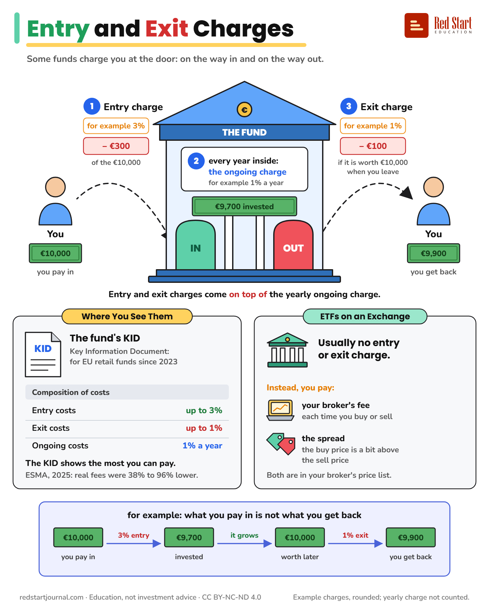

# Entry and Exit Charges

Some funds take a charge when you put money in and when you take it out, on top of the yearly cost. Where to see them.

## What the sheet says

Entry and Exit Charges. Some funds charge you at the door: on the way in and on the way out.

You pay in €10,000.

1. Entry charge, for example 3%: minus €300 of the €10,000. €9,700 is invested in the fund.

2. Every year inside: the ongoing charge, for example 1% a year.

3. Exit charge, for example 1%: minus €100, if it is worth €10,000 when you leave. You get back €9,900.

Entry and exit charges come on top of the yearly ongoing charge.

Where You See Them. The fund's KID: Key Information Document, for EU retail funds since 2023. Composition of costs: entry costs up to 3%, exit costs up to 1%, ongoing costs 1% a year. The KID shows the most you can pay. ESMA, 2025: real fees were 38% to 96% lower.

ETFs on an Exchange. Usually no entry or exit charge. Instead, you pay: your broker's fee, each time you buy or sell; and the spread: the buy price is a bit above the sell price. Both are in your broker's price list.

For example: what you pay in is not what you get back. €10,000 you pay in, 3% entry, €9,700 invested, it grows, €10,000 worth later, 1% exit, €9,900 you get back.

Example charges, rounded; yearly charge not counted. redstartjournal.com · Education, not investment advice · CC BY-NC-ND 4.0

## Sources

1. [Communication to the Industry on the Applicability of Regulation (EU) No 1286/2014 on PRIIPs KIDs to Funds and Fund Managers](https://www.mfsa.mt/wp-content/uploads/2022/12/Communication-to-the-Industry-on-the-Applicability-of-Regulation-EU-No-1286-2014-on-Key-Information-Documents-for-Packaged-Retail-and-Insurance-based-Investment-Products-PRIIPs-to-Funds-and-Fund-Managers.pdf): Malta Financial Services Authority, December 2022: from 1 January 2023, UCITS management companies must produce a PRIIPs KID for retail investors. Checked 2026-10-29.
2. [Directive (EU) 2021/2261](https://eur-lex.europa.eu/eli/dir/2021/2261/oj): EU, 2021 (EUR-Lex refused automated reading; content confirmed through source 1 and law-firm summaries): a PRIIPs KID meets the UCITS key investor information duty, from 1 January 2023; Regulation (EU) 2021/2259 ended the UCITS exemption from PRIIPs on 31 December 2022. Backs "the KID replaced the UCITS KIID for retail funds, since 2023". Checked 2026-10-29.
3. [Commission Delegated Regulation (EU) 2017/653, Annex VI](https://www.legislation.gov.uk/eur/2017/653/annex/VI/adopted): EU text as adopted, 2017: for investment funds, a one-off cost is an entry or an exit cost; the KID has a "Composition of costs" table (Annex VII). Checked 2026-10-29.
4. [Report on costs charged by UCITS management companies and AIFMs to investors: webinar](https://www.esma.europa.eu/sites/default/files/2025-11/Report_on_costs_charged_by_UCITS_management_companies_and_AIFMs_to_investors_-_Webinar.pdf): ESMA, November 2025: maximum fees in PRIIPs KIDs do not reflect actual fees; for UCITS, actual one-off (entry and exit) fees were between 38% and 96% lower than the KID maximum. Checked 2026-10-29.
5. [Finance Glossary](https://cpram.com/fra/en/individual/glossary/kid): CPR Asset Management, current: in a fund's KID, entry costs are the maximum entry fees in the prospectus, at the distributor's discretion, and exit costs the maximum exit fees. Backs "the KID shows the most you can pay". Checked 2026-10-29.
6. [UK Investment Trusts](https://janushenderson.com/en-gb/uk-investment-trusts/?p=172957): Janus Henderson, current: the entry charge is the most that may be taken from your money before it is invested (their example: 5% means £950 of £1,000 is invested). Backs how the €10,000 to €9,700 example works. Checked 2026-10-29.
7. [How to buy an ETF: Frequently asked questions](https://www.justetf.com/news/etf/wie-kaufe-ich-einen-etf-haeufig-gestellte-fragen.html): justETF, current: buying an ETF on an exchange costs your broker's standard dealing fee and the spread (an ETF costs slightly more to buy than you get for selling it); the only ongoing cost is the yearly TER. Checked 2026-10-29.
8. [ETF für Anfänger: Die häufigsten Fragen einfach erklärt](https://www.verbraucherzentrale.de/wissen/geld-versicherungen/altersvorsorge/etf-fuer-anfaenger-die-haeufigsten-fragen-einfach-erklaert-109444): Verbraucherzentrale (German consumer centres), current: ETFs are mostly available without an entry charge (Ausgabeaufschlag). Backs "usually no entry or exit charge". Checked 2026-10-29.
9. [Come funziona il trading con gli ETF?](https://www.justetf.com/it/academy/come-funziona-il-trading-con-gli-etf.html): justETF, current: the bid-ask spread is a trading cost, smaller for heavily traded ETFs. Checked 2026-10-29.
10. [ESMA consultation paper on UCITS ETFs](https://cms.law/en/int/legal-updates/esma-consultation-paper-on-ucits-etfs): CMS, 2012: ESMA's wording that ETF units bought on the secondary market are bought and sold through an intermediary such as a stockbroker, and investors may pay fees for doing so. Checked 2026-10-29.

---

From [Red Start Journal](https://education.redstartjournal.com/cheat-sheets/entry-and-exit-charges) · CC BY-NC-ND 4.0 · Education, not investment advice.
