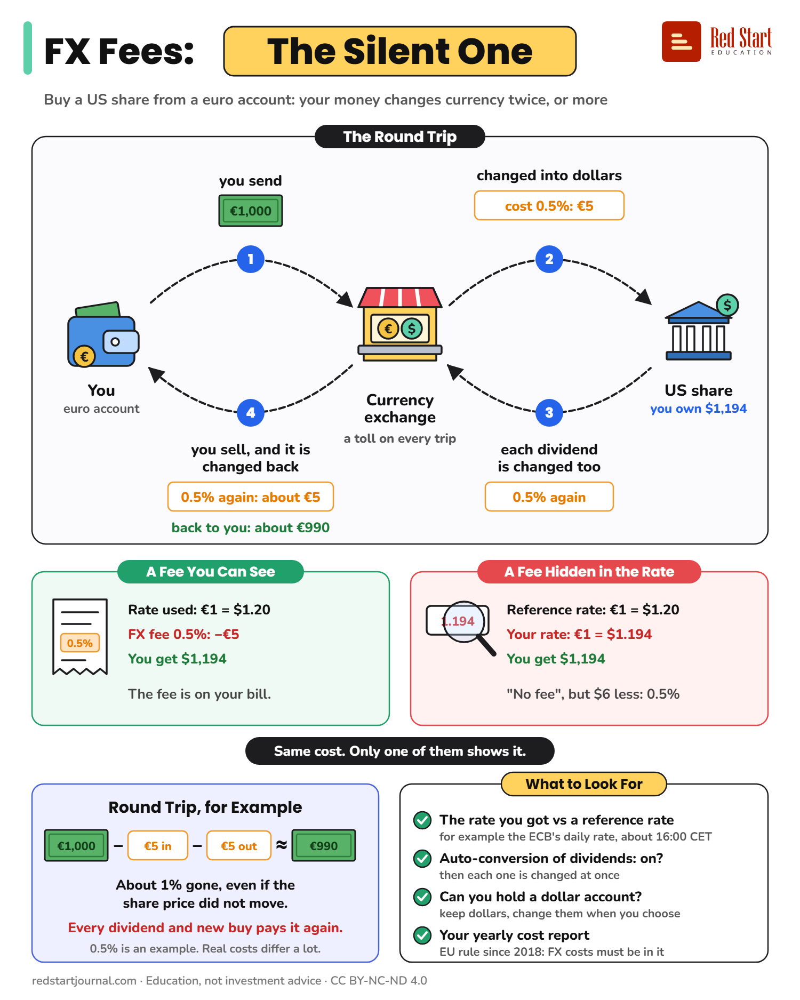

# FX Fees: The Silent One

A US share bought from a euro account changes currency on the way in, on the way out and on every dividend.

## What the sheet says

FX Fees: The Silent One.
Buy a US share from a euro account: your money changes currency twice, or more.

The Round Trip.
You. Euro account.
1. You send €1,000.
Currency exchange. A toll on every trip.
2. Changed into dollars. Cost 0.5%: €5.
US share. You own $1,194.
3. Each dividend is changed too. 0.5% again.
4. You sell, and it is changed back. 0.5% again: about €5. Back to you: about €990.

A Fee You Can See.
Rate used: €1 = $1.20. FX fee 0.5%: minus €5. You get $1,194.
The fee is on your bill.

A Fee Hidden in the Rate.
Reference rate: €1 = $1.20. Your rate: €1 = $1.194. You get $1,194.
"No fee", but $6 less: 0.5%.

Same cost. Only one of them shows it.

Round Trip, for Example.
€1,000 minus €5 in, minus €5 out, is about €990.
About 1% gone, even if the share price did not move.
Every dividend and new buy pays it again.
0.5% is an example. Real costs differ a lot.

What to Look For.
The rate you got vs a reference rate: for example the ECB's daily rate, about 16:00 CET.
Auto-conversion of dividends: on? Then each one is changed at once.
Can you hold a dollar account? Keep dollars, change them when you choose.
Your yearly cost report. EU rule since 2018: FX costs must be in it.

redstartjournal.com · Education, not investment advice · CC BY-NC-ND 4.0

## Sources

1. [Attention aux frais de change !](https://www.test-achats.be/invest/investir/marches-et-devises/devises/news/2021/11/frais-change-conversion-euros-comparaison-banques-courtiers-compte): Test-Achats Invest (Belgian consumer association), 23 November 2021: you pay a conversion cost when euros become another currency and again when the money comes back; banks and brokers usually put the cost inside the exchange rate instead of showing it; with automatic conversion, a dividend paid in a foreign currency is changed into euros at once; a foreign-currency account avoids needless conversions. Backs steps 2 to 4, "A Fee Hidden in the Rate" and the auto-conversion and dollar-account checks. Checked 2026-10-29.
2. [Frais de change : comprendre les coûts de conversion en bourse](https://www.test-achats.be/invest/formation-financiere/investir/frais/intermediaire/frais-de-change): Test-Achats Invest, lesson page (© 2026): the cost is paid twice, on the buy and on the sell; it is often hidden as a small percentage added to the official rate; some brokers let you hold several currencies. Its own worked example also uses 0.5%. Checked 2026-10-29.
3. [Q&A: how should investment firms indicate the parts of the total costs and charges paid in or represented in an amount of foreign currency](https://www.esma.europa.eu/node/206148): ESMA, 13 December 2023 (Article 50(3) of Delegated Regulation (EU) 2017/565): firms must include currency conversion costs in the costs shown before you invest and in the aggregated after-the-fact cost report. Backs "Your yearly cost report". Checked 2026-10-29.
4. [Q&As on MiFID II and MiFIR investor protection topics (ESMA35-43-349)](https://www.esma.europa.eu/sites/default/files/library/esma35-43-349_mifid_ii_qas_on_investor_protection_topics.pdf): ESMA: MiFID II, MiFIR and their delegated acts apply from 3 January 2018; firms with an ongoing client relationship send yearly cost information. Backs "EU rule since 2018". Checked 2026-10-29.
5. [Euro foreign exchange reference rates](https://www.ecb.europa.eu/stats/policy_and_exchange_rates/euro_reference_exchange_rates/html/index.en.html): European Central Bank: published for information, usually around 16:00 CET every working day. Backs the reference-rate check. Checked 2026-10-29.
6. [Regulation (EU) 2019/518 (cross-border payments, currency conversion charges)](https://www.legislation.gov.uk/eur/2019/518): Article 3a(1), applying from 19 April 2020: for card payments, EU law makes the conversion charge show as a percentage mark-up over the latest ECB euro reference rate. Not on the sheet (it covers card payments, not investing); it backs the idea of measuring a rate against the ECB reference rate. Checked 2026-10-29.

---

From [Red Start Journal](https://education.redstartjournal.com/cheat-sheets/fx-fees-the-silent-one) · CC BY-NC-ND 4.0 · Education, not investment advice.
