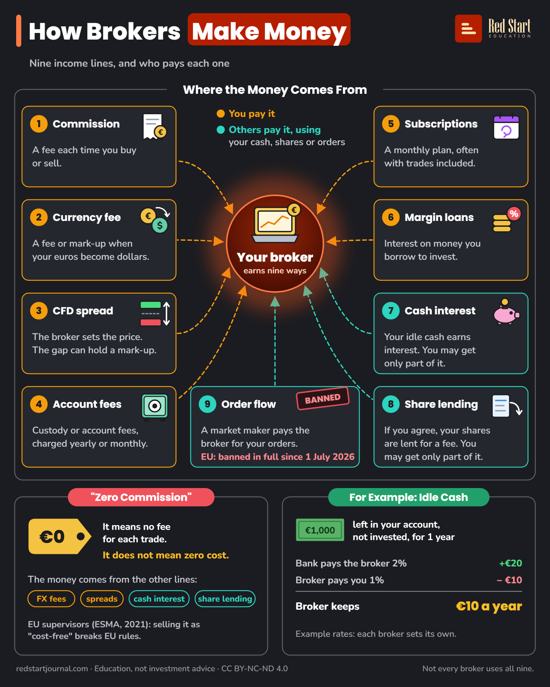

# How Brokers Make Money

The nine ways a retail broker earns, who pays each one, and why "zero commission" is not zero cost.

## What the sheet says

How Brokers Make Money.
Nine income lines, and who pays each one.

Where the Money Comes From.
You pay it. Others pay it, using your cash, shares or orders.
Your broker earns nine ways.

1. Commission: a fee each time you buy or sell.
2. Currency fee: a fee or mark-up when your euros become dollars.
3. CFD spread: the broker sets the price. The gap can hold a mark-up.
4. Account fees: custody or account fees, charged yearly or monthly.
5. Subscriptions: a monthly plan, often with trades included.
6. Margin loans: interest on money you borrow to invest.
7. Cash interest: your idle cash earns interest. You may get only part of it.
8. Share lending: if you agree, your shares are lent for a fee. You may get only part of it.
9. Order flow: a market maker pays the broker for your orders. EU: banned in full since 1 July 2026. Banned.

"Zero Commission".
€0. It means no fee for each trade. It does not mean zero cost.
The money comes from the other lines: FX fees, spreads, cash interest, share lending.
EU supervisors (ESMA, 2021): selling it as "cost-free" breaks EU rules.

For Example: Idle Cash.
€1,000 left in your account, not invested, for 1 year.
Bank pays the broker 2%: +€20.
Broker pays you 1%: minus €10.
Broker keeps €10 a year.
Example rates: each broker sets its own.

Not every broker uses all nine.
redstartjournal.com · Education, not investment advice · CC BY-NC-ND 4.0

## Sources

1. [Commission Delegated Regulation (EU) 2017/565, Annex II "Costs and charges"](http://publications.europa.eu/resource/celex/32017R0565): EU Official Journal, 2017: the cost items an EU broker must disclose, which name broker commissions, mark-ups in the transaction price, foreign exchange costs, custodian fees and custody costs (lines 1, 2, 4). Checked 2026-10-29.
2. [Neo-brokers, Consultation Report CR/02/2025](https://www.iosco.org/library/pubdocs/pdf/IOSCOPD790.pdf): IOSCO, March 2025: low or zero commission brokers depend on other revenue: payment for order flow, interest earned on margin loans and cash deposits, securities lending income; the Dutch AFM reported monthly subscription models with trading commissions included; respondents said foreign exchange charges are a large share of revenue for many neo-brokers (lines 2, 5, 6, 7, 8, 9). Checked 2026-10-29.
3. [ESMA Decision (EU) 2018/796 restricting CFDs](http://publications.europa.eu/resource/celex/32018X0601%2802%29): ESMA, 2018, recital 16 and its footnote: CFD costs include spreads, commissions, account management fees and financing charges; a spread quoted by a CFD provider may include a mark-up to the market price it faces (lines 3, 4). Checked 2026-10-29.
4. [ESMA public statement on payment for order flow and "zero-commission brokers" (ESMA35-43-2749)](https://www.esma.europa.eu/sites/default/files/library/esma35-43-2749_esma_public_statement_pfof_and_zero-commission_brokers.pdf): ESMA, 13 July 2021: zero-commission brokers often receive payment for order flow; their clients always bear costs; marketing the service as "cost-free" infringes MiFID II (line 9, the callout). Checked 2026-10-29.
5. [Regulation (EU) 2024/791, Article 39a of MiFIR](http://publications.europa.eu/resource/celex/32024R0791): EU Official Journal, 8 March 2024: ban on receiving payment for order flow, with a national exemption until 30 June 2026 (line 9). Checked 2026-10-29.
6. [List of EU Member States using the temporary exemption from the PFOF prohibition (ESMA35-335435667-5923)](https://www.esma.europa.eu/document/list-eu-member-states-using-temporary-exemption-payment-order-flow-pfof-prohibition-under): ESMA, 27 March 2024: Germany is the only Member State listed, so the ban applies everywhere from 1 July 2026 (line 9). Checked 2026-10-29.
7. [Germany's PFOF ban is now fully in force](https://legal.pwc.de/en/news/articles/germanys-pfof-ban-is-now-fully-in-force): PwC Legal, July 2026, and [BaFin outlines dos and don'ts for neobrokers after the PFOF ban took effect in Germany](https://www.regulationtomorrow.com/2026/07/bafin-outlines-key-dos-and-donts-for-neobrokers-after-the-pfof-ban-took-effect-in-germany/), Regulation Tomorrow, July 2026: Germany's exemption ended on 30 June 2026; BaFin's supervisory notice of 22 July 2026 (line 9). Checked 2026-10-29.
8. [FCA writes to firms about the treatment of retained interest on customers' cash balances](https://www.fca.org.uk/news/press-releases/fca-writes-firms-about-treatment-retained-interest-customers-cash-balances): UK FCA, December 2023: a survey of 42 platforms found most kept part of the interest earned on client cash (line 7; a non-EU regulator, cited only for how the practice works). Checked 2026-10-29.
9. [Securities lending and neobrokers, research report](https://betterfinance.eu/wp-content/uploads/Securities-lending-and-neobrokers-2025-Research-report.pdf): BETTER FINANCE, 2025: digital brokers moving towards earning on client-held assets, mainly through securities lending (line 8). Checked 2026-10-29.

---

From [Red Start Journal](https://education.redstartjournal.com/cheat-sheets/how-brokers-make-money) · CC BY-NC-ND 4.0 · Education, not investment advice.
