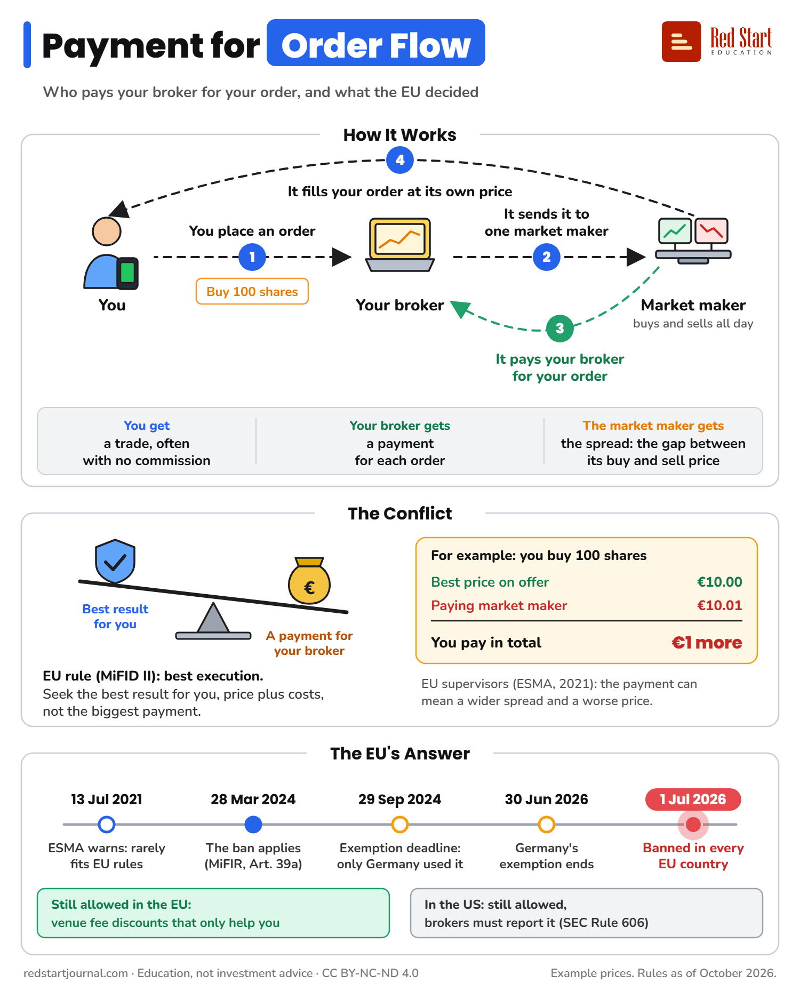

# Payment for Order Flow

A market maker pays your broker for your order. Why that clashes with best execution, and how the EU banned it (fully from July 2026).

## What the sheet says

Payment for Order Flow.
Who pays your broker for your order, and what the EU decided.

How It Works.
1. You place an order. Buy 100 shares. You, to your broker.
2. It sends it to one market maker. A market maker buys and sells all day.
3. It pays your broker for your order.
4. It fills your order at its own price.
You get a trade, often with no commission.
Your broker gets a payment for each order.
The market maker gets the spread: the gap between its buy and sell price.

The Conflict.
Best result for you, against a payment for your broker.
EU rule (MiFID II): best execution. Seek the best result for you, price plus costs, not the biggest payment.
For example: you buy 100 shares. Best price on offer: €10.00. Paying market maker: €10.01. You pay in total €1 more.
EU supervisors (ESMA, 2021): the payment can mean a wider spread and a worse price.

The EU's Answer.
13 Jul 2021: ESMA warns: rarely fits EU rules.
28 Mar 2024: the ban applies (MiFIR, Art. 39a).
29 Sep 2024: exemption deadline: only Germany used it.
30 Jun 2026: Germany's exemption ends.
1 Jul 2026: banned in every EU country.
Still allowed in the EU: venue fee discounts that only help you.
In the US: still allowed, brokers must report it (SEC Rule 606).

Example prices. Rules as of October 2026.
redstartjournal.com · Education, not investment advice · CC BY-NC-ND 4.0

## Sources

1. [Regulation (EU) 2024/791 amending MiFIR (Regulation (EU) No 600/2014)](http://publications.europa.eu/resource/celex/32024R0791): EU Official Journal, published 8 March 2024, in force on the twentieth day after (28 March 2024): new Article 39a. Paragraph 1 bans investment firms acting for retail clients (and opt-in professional clients) from receiving any fee, commission or non-monetary benefit from a third party for sending their orders to a particular venue; rebates or discounts on venue fees are allowed only where they exclusively benefit the client. Paragraph 2 lets a Member State where such firms were established before 28 March 2024 exempt them until 30 June 2026 for clients in that Member State, if it notified ESMA by 29 September 2024. Text read in full. Checked 2026-10-29.
2. [List of EU Member States using the temporary exemption from the PFOF prohibition under the MiFIR review (ESMA35-335435667-5923)](https://www.esma.europa.eu/document/list-eu-member-states-using-temporary-exemption-payment-order-flow-pfof-prohibition-under): ESMA, 27 March 2024: Germany is the only Member State listed (notified 21 March 2024). Checked 2026-10-29.
3. [Germany's PFOF ban is now fully in force](https://legal.pwc.de/en/news/articles/germanys-pfof-ban-is-now-fully-in-force): PwC Legal, July 2026: Germany's exemption expired, and since 1 July 2026 German firms may no longer accept these payments; BaFin supervisory notice 05/2026 (WA) of 22 July 2026. Checked 2026-10-29.
4. [BaFin outlines key dos and don'ts for neobrokers after the PFOF ban took effect in Germany](https://www.regulationtomorrow.com/2026/07/bafin-outlines-key-dos-and-donts-for-neobrokers-after-the-pfof-ban-took-effect-in-germany/): Regulation Tomorrow, July 2026: Germany used the exemption until 30 June 2026; the ban has applied at EU level since March 2024. Checked 2026-10-29.
5. [ESMA warns firms and investors about risks arising from payment for order flow and from certain practices by "zero-commission brokers" (ESMA35-43-2749)](https://www.esma.europa.eu/sites/default/files/library/esma35-43-2749_esma_public_statement_pfof_and_zero-commission_brokers.pdf): ESMA, 13 July 2021: PFOF is "in most cases unlikely" to be compatible with MiFID II; it creates a clear conflict of interest because it pushes the firm towards the third party that pays the most, not the best outcome for clients; best result for retail clients means total consideration (price plus costs, MiFID II Article 27(1)); it may affect the bid-ask spread and give the client a worse price. Checked 2026-10-29.
6. [SEC Adopts Rules That Increase Information Brokers Must Provide to Investors on Order Handling](https://www.sec.gov/newsroom/press-releases/2018-253): US SEC, 2 November 2018: Rule 606 public reports must describe payment for order flow arrangements. Checked 2026-10-29.
7. [Customer Account Statements (17 CFR 242.607), FR Doc. 2026-01773](https://www.govinfo.gov/content/pkg/FR-2026-01-29/html/2026-01773.htm): US SEC notice in the Federal Register, 29 January 2026 (the official copy on govinfo.gov): Rule 607 still makes US brokers disclose their payment for order flow policies on each new account and every year after, so the practice remains allowed in the US. Checked 2026-11-02.

---

From [Red Start Journal](https://education.redstartjournal.com/cheat-sheets/payment-for-order-flow) · CC BY-NC-ND 4.0 · Education, not investment advice.
