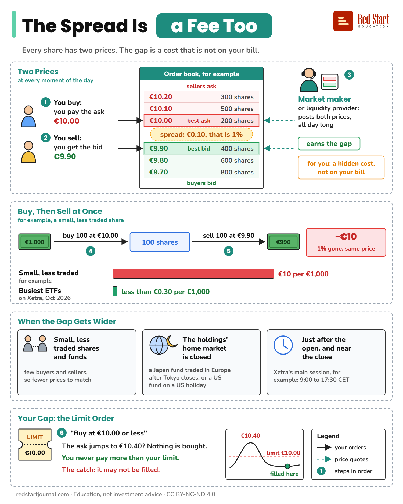

# The Spread Is a Fee Too

Every share has a buy price and a sell price. The gap is a cost you pay, and it is never on your bill.

## What the sheet says

The Spread Is a Fee Too.
Every share has two prices. The gap is a cost that is not on your bill.

Two Prices, at every moment of the day.
Order book, for example. Sellers ask: €10.20, 300 shares. €10.10, 500 shares. €10.00, 200 shares, the best ask.
Spread: €0.10, that is 1%.
Buyers bid: €9.90, 400 shares, the best bid. €9.80, 600 shares. €9.70, 800 shares.
1. You buy: you pay the ask, €10.00.
2. You sell: you get the bid, €9.90.
3. Market maker, or liquidity provider: posts both prices, all day long. Earns the gap. For you: a hidden cost, not on your bill.

Buy, Then Sell at Once. For example, a small, less traded share.
€1,000.
4. Buy 100 at €10.00. 100 shares.
5. Sell 100 at €9.90. €990.
Minus €10: 1% gone, same price.
Small, less traded, for example: €10 per €1,000.
Busiest ETFs on Xetra, October 2026: less than €0.30 per €1,000.

When the Gap Gets Wider.
Small, less traded shares and funds: few buyers and sellers, so fewer prices to match.
The holdings' home market is closed: a Japan fund traded in Europe after Tokyo closes, or a US fund on a US holiday.
Just after the open, and near the close. Xetra's main session, for example: 9:00 to 17:30 CET.

Your Cap: the Limit Order.
6. "Buy at €10.00 or less."
The ask jumps to €10.40? Nothing is bought.
You never pay more than your limit.
The catch: it may not be filled.
Chart: the price rises to €10.40 above your limit of €10.00, then falls back; filled here.
Legend: your orders; price quotes; steps in order.

redstartjournal.com · Education, not investment advice · CC BY-NC-ND 4.0

## Sources

1. [Differenziale Denaro-Lettera](https://www.borsaitaliana.it/borsa/glossario/differenziale-denaro-lettera.html): Borsa Italiana (Euronext group), financial glossary: the spread is the gap between the bid and the ask; the ask is always higher; for the dealer it is a gross profit margin, for the investor an implicit cost, apart from the commission. Backs "Two Prices", "earns the gap" and "a hidden cost, not on your bill". Checked 2026-10-29.
2. [Market Maker](https://www.borsaitaliana.it/borsa/glossario/market-maker.html): Borsa Italiana, financial glossary: an intermediary that keeps given securities tradable at all times. Backs "posts both prices, all day long". Checked 2026-10-29.
3. [Xetra Liquidity Measure (XLM)](https://www.deutsche-boerse.com/dbg-en/about-us/contact/glossary/glossary-article/Xetra-Liquidity-Measure-XLM--242940): Deutsche Börse, glossary: the more liquid a market, the lower its implicit trading cost; a higher XLM means a less liquid security. Backs "Small, less traded shares and funds". Checked 2026-10-29.
4. [Xetra Liquidity Measure for ETFs](https://cashmarket.deutsche-boerse.com/cash-en/trading/etfs-etps/xetra-liquidity-measure-etfs): Deutsche Börse: XLM is the implicit cost of a round trip (buying and selling a position at the same time); its "Top Liquids" ETFs showed about 1.6 to 2.7 basis points per round trip on the day checked, that is €0.16 to €0.27 per €1,000. Backs "less than €0.30 per €1,000" (a snapshot: it changes daily). Checked 2026-10-29.
5. [What are some of the best practices for trading ETFs?](https://www.ch.vanguard/en/professional/vanguard-365/what-are-some-of-the-best-practices-for-trading-ETFs): Vanguard Switzerland, 30 December 2025: spreads can widen at the open (some holdings have not started trading) and near the close (fewer market makers); spreads of European-listed ETFs can widen when the holdings' overseas market is closed, for example a Japanese equity ETF after the Tokyo close, or a US equity ETF on a US holiday; a limit order sets the most you pay or the least you accept, but may not be filled in full. Backs "When the Gap Gets Wider" and "The catch". Checked 2026-10-29.
6. [Trading calendar and trading hours](https://cashmarket.deutsche-boerse.com/cash-en/trading/trading-calendar-and-trading-hours): Deutsche Börse: Xetra trades Monday to Friday from 9:00 to 17:30 CET (an extra retail service runs 8:00 to 22:00). Backs "Xetra's main session: 9:00 to 17:30 CET". Checked 2026-10-29.
7. [Proposta con Limite di Prezzo](https://www.borsaitaliana.it/borsa/glossario/proposta-con-limite-di-prezzo.html): Borsa Italiana, financial glossary: a limit order names the highest price a buyer will pay or the lowest a seller will accept, and is filled only against an order at that price or better. Backs "Your Cap: the Limit Order". Checked 2026-10-29.

---

From [Red Start Journal](https://education.redstartjournal.com/cheat-sheets/the-spread-is-a-fee-too) · CC BY-NC-ND 4.0 · Education, not investment advice.
