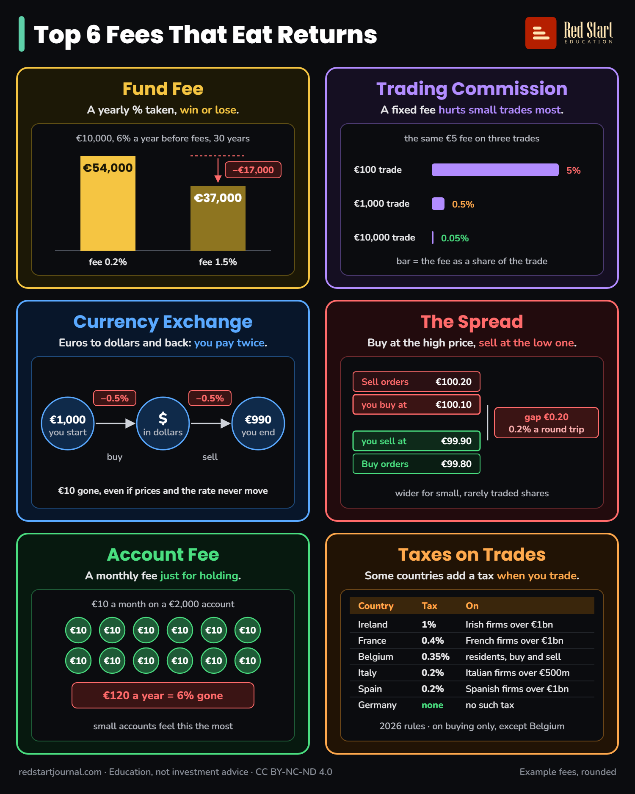

# Top 6 Fees That Eat Returns

Six costs that quietly shrink what you keep: fund fees, commissions, currency exchange, the spread, account fees and trade taxes.

## What the sheet says

Top 6 Fees That Eat Returns.

Fund Fee. A yearly % taken, win or lose.
€10,000, 6% a year before fees, 30 years.
Fee 0.2%: €54,000. Fee 1.5%: €37,000. Minus €17,000.

Trading Commission. A fixed fee hurts small trades most.
The same €5 fee on three trades.
€100 trade: 5%. €1,000 trade: 0.5%. €10,000 trade: 0.05%.
Bar = the fee as a share of the trade.

Currency Exchange. Euros to dollars and back: you pay twice.
€1,000, you start. Buy: minus 0.5%. $, in dollars. Sell: minus 0.5%. €990, you end.
€10 gone, even if prices and the rate never move.

The Spread. Buy at the high price, sell at the low one.
Sell orders €100.20. You buy at €100.10. You sell at €99.90. Buy orders €99.80.
Gap €0.20: 0.2% a round trip.
Wider for small, rarely traded shares.

Account Fee. A monthly fee just for holding.
€10 a month on a €2,000 account.
€10 twelve times. €120 a year = 6% gone.
Small accounts feel this the most.

Taxes on Trades. Some countries add a tax when you trade.
Country, tax, on:
Ireland, 1%, Irish firms over €1bn.
France, 0.4%, French firms over €1bn.
Belgium, 0.35%, residents, buy and sell.
Italy, 0.2%, Italian firms over €500m.
Spain, 0.2%, Spanish firms over €1bn.
Germany, none, no such tax.
2026 rules · on buying only, except Belgium.

redstartjournal.com · Education, not investment advice · CC BY-NC-ND 4.0
Example fees, rounded.

## Sources

1. [New investment funds drive reduction in costs to investors](https://www.esma.europa.eu/press-news/esma-news/new-investment-funds-drive-reduction-costs-investors): ESMA, 3 March 2026: ongoing costs of EU retail funds differ widely and are charged every year, reducing what investors keep. Checked 2026-10-29.
2. [Stamp duty relief for listed companies with a market capitalisation below EUR 1 billion](https://luxcsd.com/luxcsd-en/products-and-services/settlement/l25030-4826984): LuxCSD (Clearstream), 2025: Irish stamp duty on share transfers is 1%; from 1 January 2026 shares of Irish companies worth less than €1 billion are exempt. Checked 2026-10-29.
3. [Taxe sur les transactions financières (TTF) : taux et actions concernées](https://www.moneyvox.fr/bourse/taxe-transactions-financieres.php): MoneyVox, March 2026, based on CGI art. 235 ter ZD and the BOFiP list: 0.4% since 1 April 2025, on buying shares of French companies worth over €1 billion on 1 December of the year before (121 companies in 2026). Checked 2026-10-29.
4. [Tax on stock-exchange transactions](https://finances.belgium.be/en/tax-stock-exchange-transactions-0): FPS Finance Belgium: the tax applies to buying and selling securities when the order is given in Belgium, including Belgian residents using a foreign broker. Rate and cap from [TOB: what you need to know](https://curvo.eu/article/tob), Curvo, 2026: 0.35% on shares, on buys and on sells, at most €1,600 per trade. Checked 2026-10-29.
5. [2026 Budget Law: key tax changes](https://dwfgroup.com/en-ie/news-and-insights/insights/2026/1/2026-budget-law-key-tax-changes): DWF, 7 January 2026: Italy's tax on share transfers rose from 0.1% to 0.2% for trades on regulated markets and MTFs (0.4% off-exchange) from 1 January 2026. The €500 million exemption: [Italian Financial Transaction Tax](https://www.lynxbroker.com/info/italian-financial-transaction-tax/), shares of companies with an average market value under €500 million in November of the year before are not taxed. Checked 2026-10-29.
6. [Relación de sociedades ejercicio 2026](https://sede.agenciatributaria.gob.es/static_files/Sede/Tema/Declaraciones_informativas/I_Transacciones_Financieras/RELACION_SOCIEDADES_EJERCICIO_2026.pdf): Agencia Tributaria (Spain), December 2025: the 2026 list of Spanish companies worth over €1 billion on 1 December 2025, whose share purchases carry the 0.2% tax (Ley 5/2020). Checked 2026-10-29.
7. [Financial Transaction Taxes in Europe, 2026](https://www.pubt.io/view/AE0EF3BFF218EF73E1D1DE6ECFD0104DE29E7C6C): Tax Foundation (via Public Technologies), 1 June 2026: 14 European countries levy a financial transaction tax and Germany is not one of them; France 0.4% since April 2025; Italy doubled its rates from January 2026; the EU-wide FTT proposal stalled and the Commission plans to withdraw it. Checked 2026-10-29.

---

From [Red Start Journal](https://education.redstartjournal.com/cheat-sheets/top-6-fees-that-eat-returns) · CC BY-NC-ND 4.0 · Education, not investment advice.
