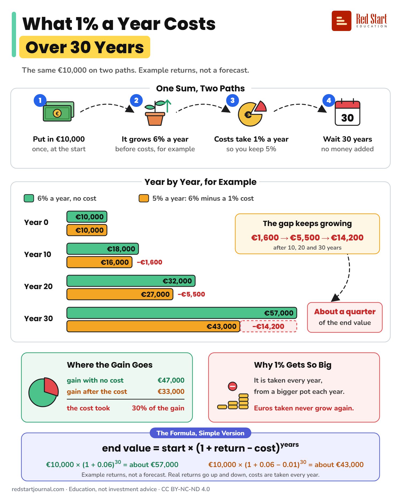

# What 1% a Year Costs Over 30 Years

The same €10,000 over 30 years, for example at 6% a year with no cost and 5% after a 1% cost: about €57,000 against €43,000.

## What the sheet says

What 1% a Year Costs Over 30 Years. The same €10,000 on two paths. Example returns, not a forecast.

One Sum, Two Paths.
1. Put in €10,000, once, at the start.
2. It grows 6% a year, before costs, for example.
3. Costs take 1% a year, so you keep 5%.
4. Wait 30 years, no money added.

Year by Year, for Example. Green: 6% a year, no cost. Orange: 5% a year: 6% minus a 1% cost.
Year 0: €10,000 and €10,000.
Year 10: €18,000 and €16,000, a gap of €1,600.
Year 20: €32,000 and €27,000, a gap of €5,500.
Year 30: €57,000 and €43,000, a gap of €14,200.
The gap keeps growing: €1,600, then €5,500, then €14,200, after 10, 20 and 30 years. About a quarter of the end value.

Where the Gain Goes. Gain with no cost: €47,000. Gain after the cost: €33,000. The cost took 30% of the gain.

Why 1% Gets So Big. It is taken every year, from a bigger pot each year. Euros taken never grow again.

The Formula, Simple Version. End value = start × (1 + return − cost) to the power of years.
€10,000 × (1 + 0.06) to the power of 30 = about €57,000.
€10,000 × (1 + 0.06 − 0.01) to the power of 30 = about €43,000.
Example returns, not a forecast. Real returns go up and down, costs are taken every year.

redstartjournal.com · Education, not investment advice · CC BY-NC-ND 4.0

## Sources

1. [New investment funds drive reduction in costs to investors](https://www.esma.europa.eu/press-news/esma-news/new-investment-funds-drive-reduction-costs-investors): ESMA, 3 March 2026: costs and performance are key to what retail investors get from funds; ongoing costs are charged every year. Checked 2026-10-29.
2. [Commission Delegated Regulation (EU) 2017/565, Annex II](https://legislation.gov.uk/eur/2017/565/annexes/2020-01-31): (EU text as published, also on [EUR-Lex](https://eur-lex.europa.eu/eli/reg_del/2017/565/oj/eng)): ongoing charges are deducted from the value of the financial instrument during the investment, the reason a yearly cost compounds. Checked 2026-10-29.

---

From [Red Start Journal](https://education.redstartjournal.com/cheat-sheets/what-1-a-year-costs-over-30-years) · CC BY-NC-ND 4.0 · Education, not investment advice.
