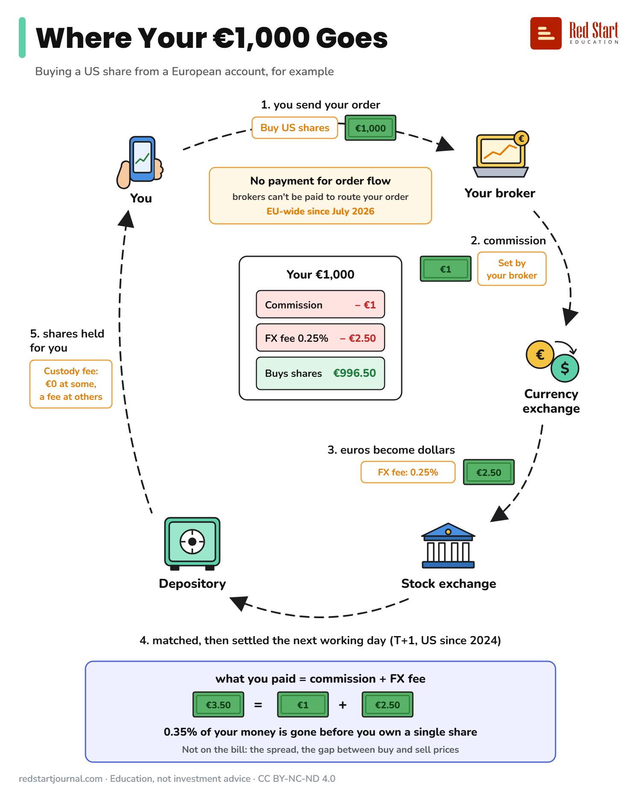

# Where Your €1,000 Goes

Buying a US share from a European account: the fees your €1,000 meets on the way, step by step.

## What the sheet says

Where Your €1,000 Goes.
Buying a US share from a European account, for example.

You.
1. You send your order. Buy US shares. €1,000.
Your broker.
2. Commission. Set by your broker. €1.
No payment for order flow. Brokers can't be paid to route your order. EU-wide since July 2026.
Your €1,000: Commission, minus €1.
Currency exchange.
3. Euros become dollars. FX fee: 0.25%. €2.50.
Your €1,000: FX fee 0.25%, minus €2.50.
Stock exchange.
Your €1,000: Buys shares, €996.50.
4. Matched, then settled the next working day (T+1, US since 2024).
Depository.
5. Shares held for you. Custody fee: €0 at some, a fee at others.

What you paid = commission + FX fee.
€3.50 = €1 + €2.50.
0.35% of your money is gone before you own a single share.
Not on the bill: the spread, the gap between buy and sell prices.

redstartjournal.com · Education, not investment advice · CC BY-NC-ND 4.0

## Sources

1. [New "T+1" Settlement Cycle: What Investors Need To Know](https://www.sec.gov/oiea/investor-alerts-and-bulletins/new-t1-settlement-cycle-what-investors-need-know-investor): US SEC, 2024: US share trades settle one business day after the trade (T+1) since 28 May 2024. Checked 2026-10-29.
2. [Regulation (EU) 2024/791 amending MiFIR (Article 39a)](https://eur-lex.europa.eu/eli/reg/2024/791/oj): EUR-Lex, 2024: investment firms may not receive payment from third parties for routing client orders (in force since 28 March 2024; a member state could exempt its own clients until 30 June 2026). Checked 2026-10-29.
3. [BaFin outlines key dos and don'ts for neobrokers after the PFOF ban took effect in Germany](https://www.regulationtomorrow.com/2026/07/bafin-outlines-key-dos-and-donts-for-neobrokers-after-the-pfof-ban-took-effect-in-germany/): Regulation Tomorrow, July 2026: the last national exemption (Germany) ended on 30 June 2026, so the ban applies EU-wide from 1 July 2026. Checked 2026-10-29.
4. [Depotkosten im Vergleich](https://www.test.de/Depotkosten-im-Vergleich-4864312-0/): Stiftung Warentest, 2025: some securities accounts cost nothing, many branch-bank accounts charge a yearly fee. Backs "€0 at some, a fee at others". Checked 2026-10-29.

---

From [Red Start Journal](https://education.redstartjournal.com/cheat-sheets/where-your-1000-euros-goes) · CC BY-NC-ND 4.0 · Education, not investment advice.
