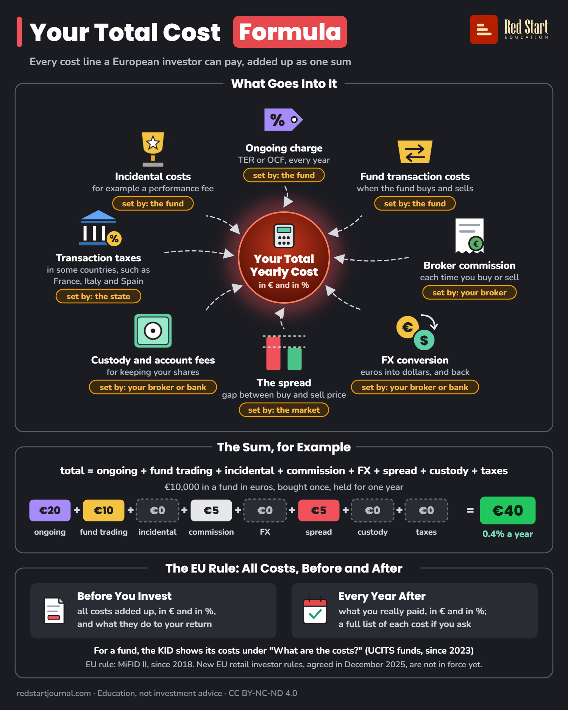

# Your Total Cost Formula

Every cost line a European investor can pay, added up as one yearly sum, and the EU rule that firms must show it before and after.

## What the sheet says

Your Total Cost Formula. Every cost line a European investor can pay, added up as one sum.

What Goes Into It. In the centre: your total yearly cost, in € and in %.
- Ongoing charge: TER or OCF, every year. Set by: the fund.
- Fund transaction costs: when the fund buys and sells. Set by: the fund.
- Broker commission: each time you buy or sell. Set by: your broker.
- FX conversion: euros into dollars, and back. Set by: your broker or bank.
- The spread: gap between buy and sell price. Set by: the market.
- Custody and account fees: for keeping your shares. Set by: your broker or bank.
- Transaction taxes: in some countries, such as France, Italy and Spain. Set by: the state.
- Incidental costs: for example a performance fee. Set by: the fund.

The Sum, for Example. Total = ongoing + fund trading + incidental + commission + FX + spread + custody + taxes.
€10,000 in a fund in euros, bought once, held for one year: €20 ongoing + €10 fund trading + €0 incidental + €5 commission + €0 FX + €5 spread + €0 custody + €0 taxes = €40, that is 0.4% a year.

The EU Rule: All Costs, Before and After.
Before You Invest: all costs added up, in € and in %, and what they do to your return.
Every Year After: what you really paid, in € and in %; a full list of each cost if you ask.
For a fund, the KID shows its costs under "What are the costs?" (UCITS funds, since 2023).
EU rule: MiFID II, since 2018. New EU retail investor rules, agreed in December 2025, are not in force yet.

redstartjournal.com · Education, not investment advice · CC BY-NC-ND 4.0

## Sources

1. [Directive 2014/65/EU (MiFID II), Article 24(4)](https://eur-lex.europa.eu/eli/dir/2014/65/oj/eng): EU, 2014, applies since 3 January 2018: costs of the service and the instrument must be aggregated so the client understands the overall cost and the cumulative effect on return; an itemised breakdown when the client asks; given regularly, at least annually. Wording cross-checked with [ESMA's Q&A on investor protection](https://www.esma.europa.eu/print/pdf/node/204202). Checked 2026-10-29.
2. [Commission Delegated Regulation (EU) 2017/565, Article 50](https://legislation.gov.uk/eur/2017/565/article/50/2020-01-31): (EU text as published; also [EUR-Lex](https://eur-lex.europa.eu/eli/reg_del/2017/565/oj/eng)): aggregated costs as a cash amount and as a percentage (50(2)); ex-ante in good time (50(5)); ex-post at least annually, personalised, while there is an ongoing relationship (50(9)); an illustration of the cumulative effect of costs on return (50(10)). Checked 2026-10-29.
3. [Delegated Regulation (EU) 2017/565, Annex II](https://legislation.gov.uk/eur/2017/565/annexes/2020-01-31): the cost lines: ongoing charges (management fees, custodian fees), transaction costs (broker commissions, mark-ups embedded in the price, i.e. the spread, stamp duty, transaction tax, foreign exchange costs), incidental costs (performance fees), on both the service side and the product side. Checked 2026-10-29.
4. [Extension of the preparation of a Key Information Document to all collective investments](https://www.amf-france.org/en/news-publications/news/extension-preparation-key-information-document-all-collective-investments-amf-updates-its-policy): AMF (France), 2022: since 1 January 2023 UCITS give retail investors a PRIIPs KID instead of the UCITS KIID (Regulation (EU) 2021/2259, Directive (EU) 2021/2261). Also [CONSOB notice, 14 October 2022](https://www.consob.it/documents/1912911/1932284/pr_20221014.pdf/216d307e-4a00-e83d-28ca-5010d08e7412). Checked 2026-10-29.
5. [Regulation (EU) No 1286/2014 (PRIIPs), Article 8(3)](https://eur-lex.europa.eu/eli/reg/2014/1286/oj/eng): and [Delegated Regulation (EU) 2021/2268](https://eur-lex.europa.eu/eli/reg_del/2021/2268/oj/eng): the KID has a section titled "What are the costs?" with the "Costs over time" and "Composition of costs" tables (headings confirmed in [Arendt's UCITS PRIIPs KID note, 2022](https://www.arendt.com/wp-content/uploads/2024/04/2022.05.31_ucits_priips_kid.pdf)). Checked 2026-10-29.
6. [Retail investment strategy: Council and Parliament agree on package](https://www.consilium.europa.eu/en/press/press-releases/2025/12/18/retail-investment-strategy-council-and-parliament-agree-on-package-to-empower-consumers-while-boosting-markets/): Council of the EU, 18 December 2025: provisional agreement only. The Commission's [request to ESMA for technical advice](https://www.esma.europa.eu/sites/default/files/2026-08/Call_for_advice_on_RIS_to_ESMA.pdf) (August 2026) expects publication in the Official Journal by January 2027 at the latest, with application later. Checked 2026-10-29.

---

From [Red Start Journal](https://education.redstartjournal.com/cheat-sheets/your-total-cost-formula) · CC BY-NC-ND 4.0 · Education, not investment advice.
