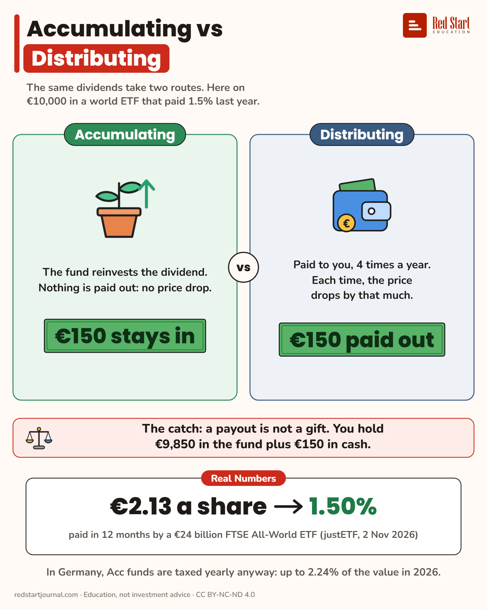

# Accumulating vs Distributing

The same dividends take two routes. A payout is not a gift: on each pay date the fund price drops by the amount paid.

## What the sheet says

Accumulating vs Distributing.
The same dividends take two routes. Here on €10,000 in a world ETF that paid 1.5% last year.

Accumulating: the fund reinvests the dividend. Nothing is paid out: no price drop. €150 stays in.
Distributing: paid to you, 4 times a year. Each time, the price drops by that much. €150 paid out.

The catch: a payout is not a gift. You hold €9,850 in the fund plus €150 in cash.
Real numbers: €2.13 a share, 1.50%, paid in 12 months by a €24 billion FTSE All-World ETF (justETF, 2 Nov 2026).
In Germany, Acc funds are taxed yearly anyway: up to 2.24% of the value in 2026.

## Sources

1. [Vanguard FTSE All-World UCITS ETF (USD) Distributing, IE00B3RBWM25](https://www.justetf.com/en/etf-profile.html?isin=IE00B3RBWM25): justETF, read 2 Nov 2026: distributing, quarterly; dividends in the last 12 months EUR 2.13 a share, 1-year yield 1.50%; fund size EUR 23,862 m. Named here only; the sheet says "a €24 billion FTSE All-World ETF". Checked 2026-11-02.
2. [Mutual Fund Distribution FAQs](https://www.janushenderson.com/en-us/investor/planning/mutual-fund-distribution-faqs/): Janus Henderson, and [Tax and distribution FAQs](https://bailliegifford.com/literature-library/funds/mutual-funds/tax-and-distribution-faqs), Baillie Gifford: on the ex-dividend date the NAV falls by the amount distributed, market moves aside. Checked 2026-11-02.
3. [Distributing or Accumulating ETFs](https://justetf.com/en/news/etf/distributing-or-accumulating-etfs-how-to-handle-investment-income.html): justETF: accumulating ETFs reinvest income automatically. Checked 2026-11-02.

---

From [Red Start Journal](https://education.redstartjournal.com/cheat-sheets/accumulating-vs-distributing) · CC BY-NC-ND 4.0 · Education, not investment advice.
