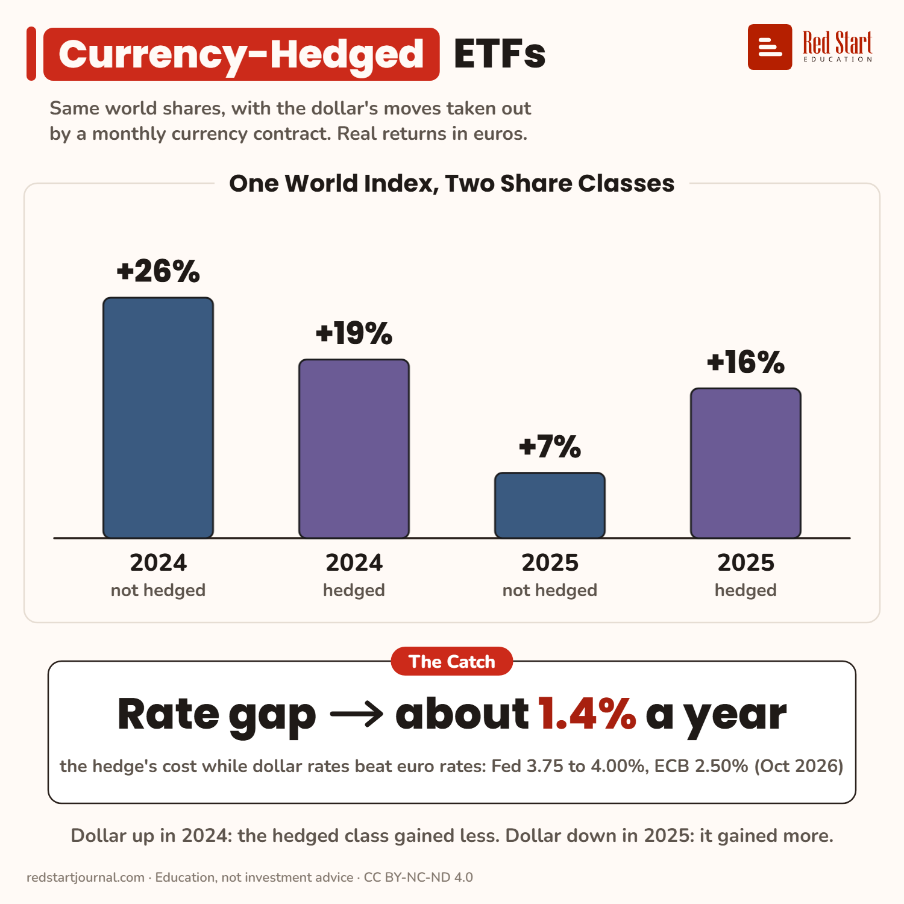

# Currency-Hedged ETFs

A hedged class takes the dollar out of a world fund. 2024 +19% vs +26%, 2025 +16% vs +7%, and the hedge costs about 1.4% a year now.

## What the sheet says

Currency-Hedged ETFs.
Same world shares, with the dollar's moves taken out by a monthly currency contract. Real returns in euros.

One world index, two share classes.
2024, not hedged: +26%. 2024, hedged: +19%.
2025, not hedged: +7%. 2025, hedged: +16%.

The catch: rate gap → about 1.4% a year: the hedge's cost while dollar rates beat euro rates: Fed 3.75 to 4.00%, ECB 2.50% (Oct 2026).
Dollar up in 2024: the hedged class gained less. Dollar down in 2025: it gained more.

## Sources

1. [iShares MSCI World EUR Hedged UCITS ETF (Acc), IE00B441G979](https://www.justetf.com/en/etf-profile.html?isin=IE00B441G979): justETF, read 2 Nov 2026: hedged to EUR; TER 0.55%; calendar returns 2024 +19.49%, 2025 +16.34% (2022 −18.12%, 2023 +20.62%, 2026 to date +9.90%). Named here only. Checked 2026-11-02.
2. [iShares Core MSCI World UCITS ETF USD (Acc), IE00B4L5Y983](https://www.justetf.com/en/etf-profile.html?isin=IE00B4L5Y983&tab=returns): justETF, read 2 Nov 2026: not hedged; TER 0.20%; calendar returns 2024 +26.24%, 2025 +7.12% (2022 −12.96%, the EUR figure used in "What UCITS Means"). Named here only. Checked 2026-11-02.
3. [How currency-hedged ETFs protect you from currency risk](https://www.justetf.com/en-it/news/etf/why-currency-hedged-etfs-are-rising-in-popularity.html): justETF (Jan Altmann), 27 May 2019: hedged ETFs typically use forward exchange contracts, often expiring monthly; the cost of carry is set by the interest rate gap between the two currencies; hedged ETFs often cost 0.1% to 0.3% more in TER. Checked 2026-11-02.
4. [FOMC statement](https://www.federalreserve.gov/newsevents/pressreleases/monetary20261028a.htm): Federal Reserve, 28 Oct 2026: target range 3-3/4 to 4 percent. [Key ECB interest rates](https://www.ecb.europa.eu/stats/policy_and_exchange_rates/key_ecb_interest_rates/html/index.en.html), ECB, read 2 Nov 2026: deposit facility rate 2.50% from 16 Sep 2026. Checked 2026-11-02.

---

From [Red Start Journal](https://education.redstartjournal.com/cheat-sheets/currency-hedged-etfs) · CC BY-NC-ND 4.0 · Education, not investment advice.
