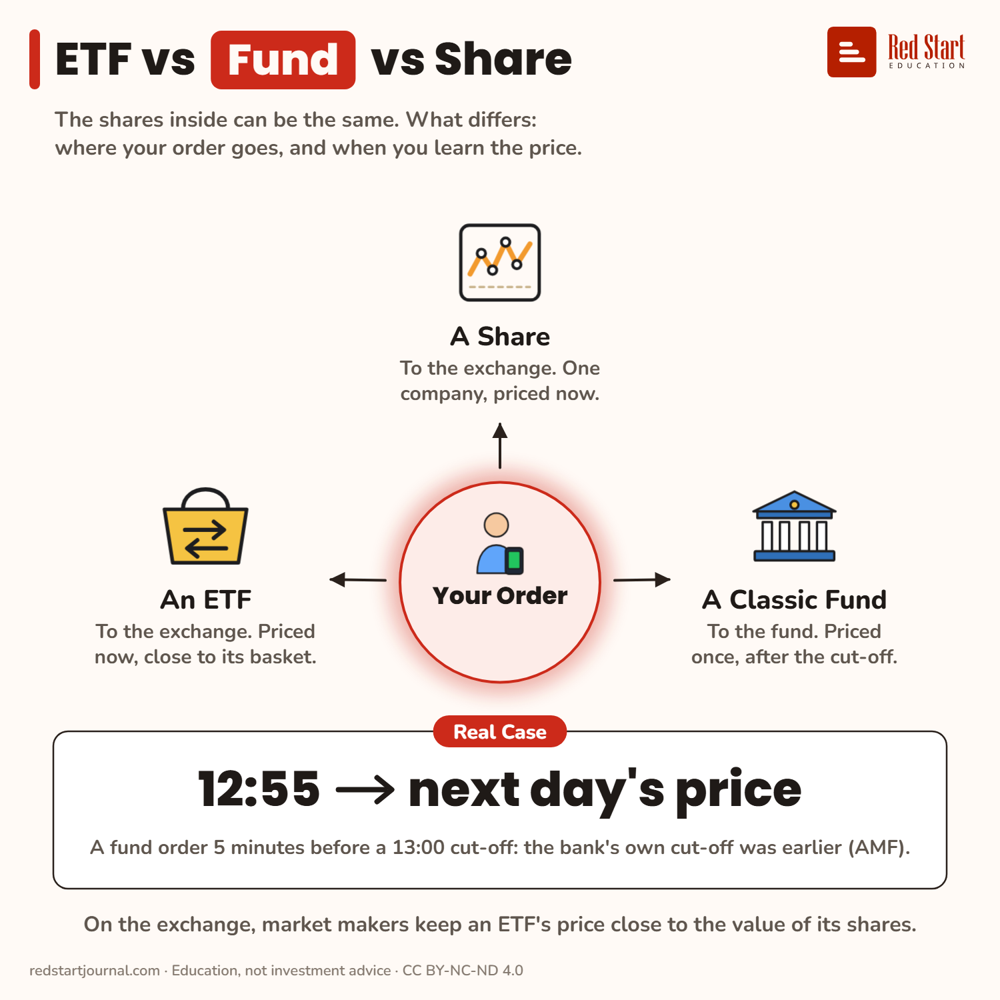

# ETF vs Fund vs Share

A share or an ETF is priced now, on an exchange. A classic fund is priced once, after the cut-off, and the bank's cut-off can be earlier.

## What the sheet says

ETF vs Fund vs Share.
The shares inside can be the same. What differs: where your order goes, and when you learn the price.

In the centre: your order.
A Share: to the exchange. One company, priced now.
A Classic Fund: to the fund. Priced once, after the cut-off.
An ETF: to the exchange. Priced now, close to its basket.

Real case: 12:55, next day's price. A fund order 5 minutes before a 13:00 cut-off: the bank's own cut-off was earlier (AMF).
On the exchange, market makers keep an ETF's price close to the value of its shares.

## Sources

1. [ETF vs mutual fund](https://www.finra.org/investors/insights/etf-vs-mutual-fund): FINRA: funds priced once a day at NAV; ETF prices can differ a little from NAV during the day. Checked 2026-11-02.

---

From [Red Start Journal](https://education.redstartjournal.com/cheat-sheets/etf-vs-fund-vs-share) · CC BY-NC-ND 4.0 · Education, not investment advice.
