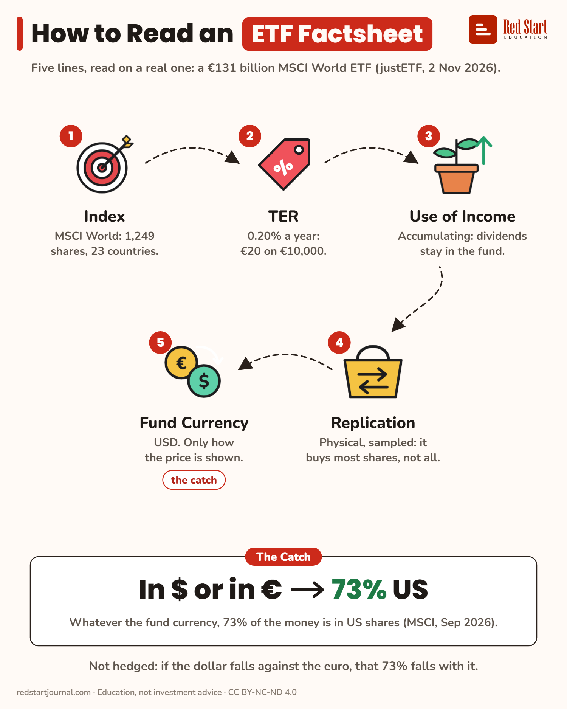

# How to Read an ETF Factsheet

Five lines, read on a real €131 billion MSCI World ETF. The fund currency is not your risk: 73% of the money sits in US shares.

## What the sheet says

How to Read an ETF Factsheet.
Five lines, read on a real one: a €131 billion MSCI World ETF (justETF, 2 Nov 2026).

1. Index: MSCI World: 1,249 shares, 23 countries.
2. TER: 0.20% a year: €20 on €10,000.
3. Use of Income: accumulating: dividends stay in the fund.
4. Replication: physical, sampled: it buys most shares, not all.
5. Fund Currency: USD. Only how the price is shown. The catch.

The catch: in $ or in €, 73% US. Whatever the fund currency, 73% of the money is in US shares (MSCI, Sep 2026).
Not hedged: if the dollar falls against the euro, that 73% falls with it.

## Sources

1. [iShares Core MSCI World UCITS ETF, IE00B4L5Y983](https://www.justetf.com/en/etf-profile.html?isin=IE00B4L5Y983): justETF, read 2 Nov 2026: index MSCI World, TER 0.20%, accumulating, physical (optimised sampling), fund currency USD, domicile Ireland, fund size EUR 131,264 m, 1,249 holdings, not currency hedged. Named here only. Checked 2026-11-02.
2. [ETF currency risk: How to handle it](https://www.justetf.com/en/news/etf/the-effect-of-currencies-on-etfs.html): justETF, 17 June 2021: the fund currency is the reporting currency; the currencies of the holdings decide the exposure. Checked 2026-11-02.

---

From [Red Start Journal](https://education.redstartjournal.com/cheat-sheets/how-to-read-an-etf-factsheet) · CC BY-NC-ND 4.0 · Education, not investment advice.
