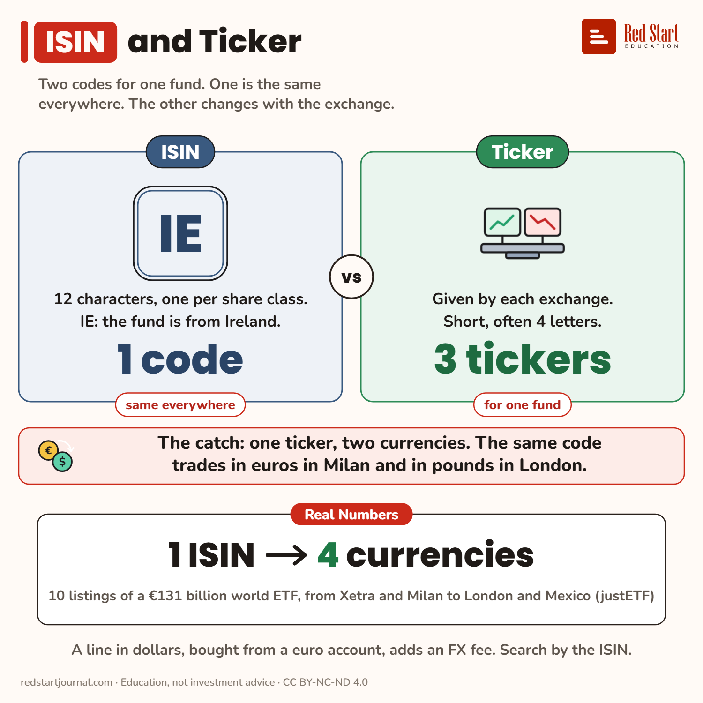

# ISIN and Ticker

One fund, one ISIN, many tickers. A €131 billion world ETF has 10 listings in 4 currencies, and one ticker means two currencies.

## What the sheet says

ISIN and Ticker.
Two codes for one fund. One is the same everywhere. The other changes with the exchange.

ISIN: 12 characters, one per share class. IE: the fund is from Ireland. 1 code, same everywhere.
Ticker: given by each exchange. Short, often 4 letters. 3 tickers for one fund.

The catch: one ticker, two currencies. The same code trades in euros in Milan and in pounds in London.
Real numbers: 1 ISIN → 4 currencies. 10 listings of a €131 billion world ETF, from Xetra and Milan to London and Mexico (justETF).
A line in dollars, bought from a euro account, adds an FX fee. Search by the ISIN.

## Sources

1. [iShares Core MSCI World UCITS ETF USD (Acc), IE00B4L5Y983](https://www.justetf.com/en/etf-profile.html?isin=IE00B4L5Y983): justETF, read 2 Nov 2026: listings gettex EUR EUNL, Stuttgart EUR EUNL, Bolsa Mexicana MXN (no ticker shown), Borsa Italiana EUR SWDA, Euronext Amsterdam EUR IWDA, London Stock Exchange GBX SWDA, USD IWDA and GBP SWDA, SIX Swiss Exchange USD SWDA, XETRA EUR EUNL: 10 listings, 3 tickers, 4 currencies (EUR, GBP in pounds and pence, USD, MXN); fund size EUR 131,264 m; domicile Ireland. Named here only. Checked 2026-11-02.

---

From [Red Start Journal](https://education.redstartjournal.com/cheat-sheets/isin-and-ticker) · CC BY-NC-ND 4.0 · Education, not investment advice.
