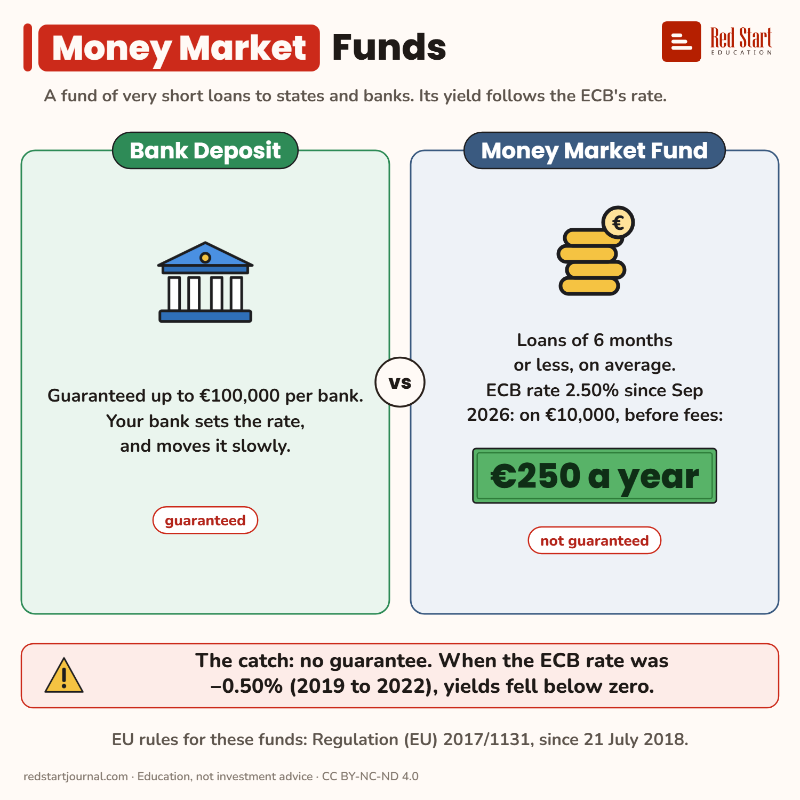

# Money Market Funds

A fund of very short loans whose yield follows the ECB rate: about €250 a year on €10,000 now, below zero in 2019 to 2022. No guarantee.

## What the sheet says

Money Market Funds.
A fund of very short loans to states and banks. Its yield follows the ECB's rate.

Bank Deposit: guaranteed up to €100,000 per bank. Your bank sets the rate, and moves it slowly. Guaranteed.
Money Market Fund: loans of 6 months or less, on average. ECB rate 2.50% since Sep 2026: on €10,000, before fees: €250 a year. Not guaranteed.

The catch: no guarantee. When the ECB rate was −0.50% (2019 to 2022), yields fell below zero.
EU rules for these funds: Regulation (EU) 2017/1131, since 21 July 2018.

## Sources

1. [Key ECB interest rates](https://www.ecb.europa.eu/stats/policy_and_exchange_rates/key_ecb_interest_rates/html/index.en.html): ECB, read 2 Nov 2026: deposit facility rate −0.50% from 18 Sep 2019, 0.00% from 27 Jul 2022; 2.50% from 16 Sep 2026 (latest). Checked 2026-11-02.
2. [Regulation (EU) 2017/1131, Article 25](https://www.legislation.gov.uk/eur/2017/1131/article/25/adopted): standard MMFs, weighted average maturity at most 6 months (Article 24: short-term MMFs, 60 days); [Article 36(3)](https://www.legislation.gov.uk/eur/2017/1131/article/36/adopted): not guaranteed, not a deposit, the investor bears losses. Applies from 21 July 2018 ([CSSF](https://www.cssf.lu/en/2018/07/entry-into-force-of-the-money-market-fund-regulation/)). Checked 2026-11-02.

---

From [Red Start Journal](https://education.redstartjournal.com/cheat-sheets/money-market-funds) · CC BY-NC-ND 4.0 · Education, not investment advice.
