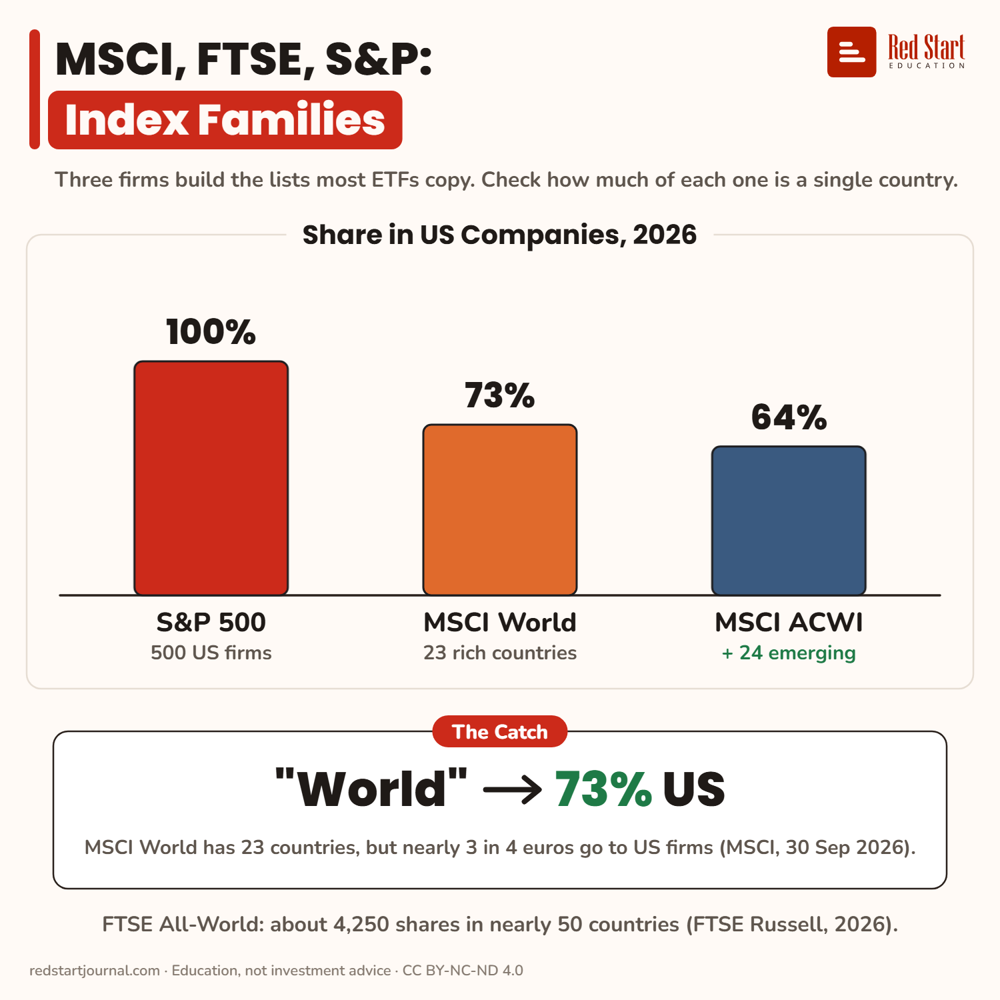

# MSCI, FTSE, S&P: Index Families

Three firms build the lists most ETFs copy. MSCI World has 23 countries, but 73% of it is US companies.

## What the sheet says

MSCI, FTSE, S&P: Index Families.
Three firms build the lists most ETFs copy. Check how much of each one is a single country.

Share in US companies, 2026.
S&P 500: 100%. 500 US firms.
MSCI World: 73%. 23 rich countries.
MSCI ACWI: 64%. Plus 24 emerging.

The catch: "World", 73% US. MSCI World has 23 countries, but nearly 3 in 4 euros go to US firms (MSCI, 30 Sep 2026).
FTSE All-World: about 4,250 shares in nearly 50 countries (FTSE Russell, 2026).

## Sources

1. [Expand your view: know your world index](https://www.lseg.com/en/insights/ftse-russell/expand-your-view-know-your-world-index): FTSE Russell, 1 April 2026: FTSE All-World, nearly 50 developed and emerging markets, just over 4,250 stocks (Sep 2025). Checked 2026-11-02.

---

From [Red Start Journal](https://education.redstartjournal.com/cheat-sheets/msci-ftse-sandp-index-families) · CC BY-NC-ND 4.0 · Education, not investment advice.
