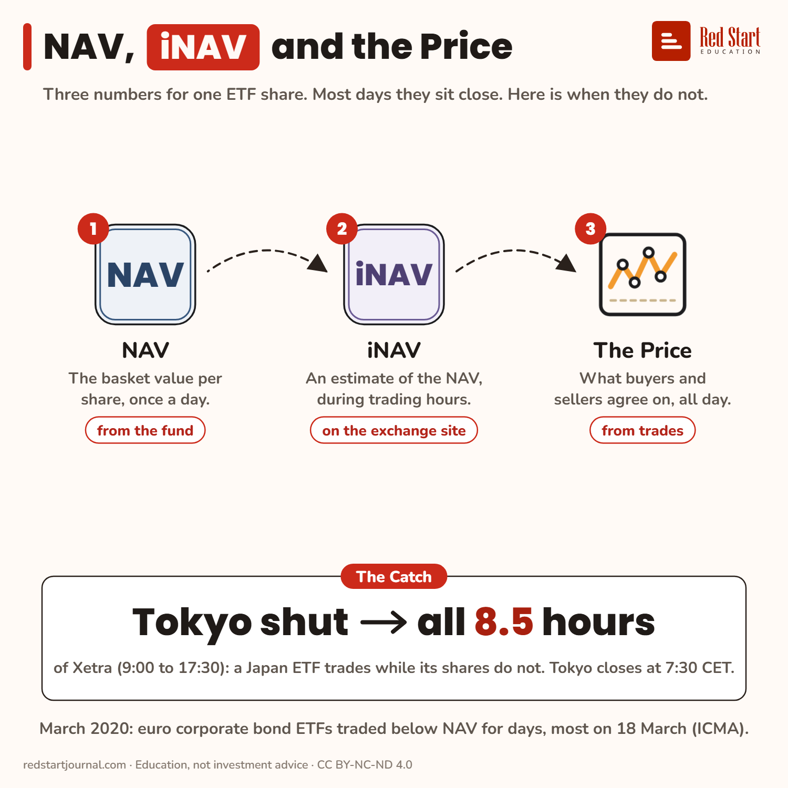

# NAV, iNAV and the Price

Three numbers for one ETF share. Most days they sit close, but a Japan ETF on Xetra trades all day while Tokyo is shut.

## What the sheet says

NAV, iNAV and the Price.
Three numbers for one ETF share. Most days they sit close. Here is when they do not.

1. NAV: the basket value per share, once a day. From the fund.
2. iNAV: an estimate of the NAV, during trading hours. On the exchange site.
3. The Price: what buyers and sellers agree on, all day. From trades.

The catch: Tokyo shut → all 8.5 hours of Xetra (9:00 to 17:30): a Japan ETF trades while its shares do not. Tokyo closes at 7:30 CET.
March 2020: euro corporate bond ETFs traded below NAV for days, most on 18 March (ICMA).

## Sources

1. [ICMA response to the IOSCO questionnaire on ETFs](https://www.icmagroup.org/assets/documents/Regulatory/AMIC/ICMA-response-ETF-survey-IOSCO-010321.pdf): ICMA, March 2021: ETF prices come from live trading while the NAV is set at a single point in time; European bond ETFs traded at a discount from 9 to 23 March 2020, most stretched on 18 March (the day the ECB announced its package); iNAVs are most useful for holdings that trade at the same time as the ETF. Checked 2026-11-02 (the % in its chart were not read off; none are on the sheet).
2. [Key Investor Information, iShares Core MSCI World UCITS ETF](https://www.ishares.com/gls-download/literature/kiid/ucits_kiid-ishares-core-msci-world-ucits-etf-gb-ie00b4l5y983-en.pdf): BlackRock, 9 Feb 2026: "Indicative net asset value is published on relevant stock exchanges websites." Checked 2026-11-02.
3. [KID, State Street SPDR MSCI World UCITS ETF](https://www.ssga.com/library-content/kids?isin=IE00BFY0GT14&documentType=kid&country=it&language=en_gb&ticker=sppw-gy): 19 Feb 2026: market prices may be greater or less than the daily net asset value; the price for the day is set after the valuation point. Checked 2026-11-02.
4. [JPX: extension of trading hours](https://www.jpx.co.jp/english/corporate/news/news-releases/1030/20230920-01.html): Japan Exchange Group: the Tokyo Stock Exchange closes at 15:30 Japan time since 5 November 2024 (06:30 GMT, so 07:30 CET in winter, 08:30 CEST in summer). Checked 2026-11-02.

---

From [Red Start Journal](https://education.redstartjournal.com/cheat-sheets/nav-inav-and-the-price) · CC BY-NC-ND 4.0 · Education, not investment advice.
