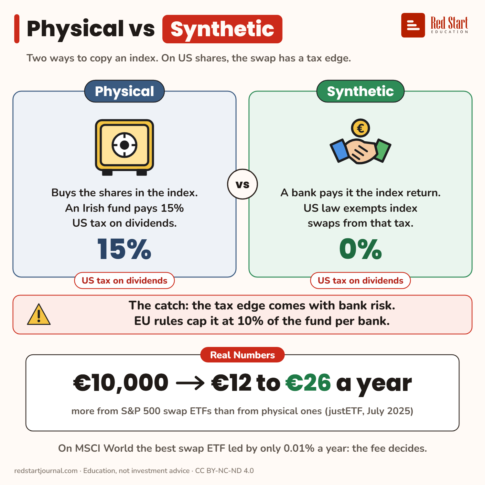

# Physical vs Synthetic

On US shares a swap ETF skips the 15% US dividend tax a physical Irish fund pays. The edge comes with bank risk, capped at 10%.

## What the sheet says

Physical vs Synthetic.
Two ways to copy an index. On US shares, the swap has a tax edge.

Physical: buys the shares in the index. An Irish fund pays 15% US tax on dividends. 15%: US tax on dividends.
Synthetic: a bank pays it the index return. US law exempts index swaps from that tax. 0%: US tax on dividends.

The catch: the tax edge comes with bank risk. EU rules cap it at 10% of the fund per bank.
Real numbers: €10,000 → €12 to €26 a year more from S&P 500 swap ETFs than from physical ones (justETF, July 2025).
On MSCI World the best swap ETF led by only 0.01% a year: the fee decides.

## Sources

1. [Why synthetic ETFs have the edge in US-dominated markets](https://www.justetf.com/en/academy/synthetic-etfs-in-us-dominated-markets.html): justETF, 9 July 2025 (data to 30 June 2025): Irish physical funds pay 15% US withholding (30% standard rate halved); swap ETFs 0%, as US law exempts swaps on indices such as the S&P 500 and MSCI World; S&P 500: synthetic ETFs ahead of physical ones by 0.12% to 0.26% a year; MSCI World: the leading synthetic ahead of the best physical by 0.01% a year, one swap ETF has a TER of 0.45% against 0.06% for cheap physical ones. Checked 2026-11-02.
2. [UCITS Directive, Article 52(1)](https://www.esma.europa.eu/publications-and-data/interactive-single-rulebook/ucits/article-52): ESMA single rulebook: counterparty risk to one credit institution on non-centrally cleared derivatives at most 10% of assets. Checked 2026-11-02.
3. [Swap ETFs: Synthetic replication of ETFs](https://www.justetf.com/en/academy/synthetic-replication-of-etfs.html): justETF: the swap counterparty pays the index return; the fund holds a substitute basket. Checked 2026-11-02.

---

From [Red Start Journal](https://education.redstartjournal.com/cheat-sheets/physical-vs-synthetic) · CC BY-NC-ND 4.0 · Education, not investment advice.
