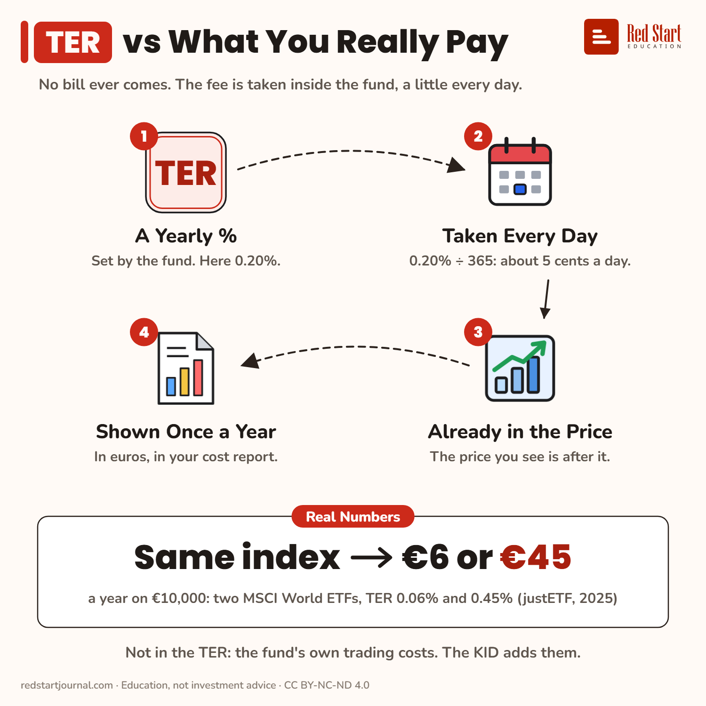

# TER vs What You Really Pay

No bill ever comes: the TER is taken inside the fund every day. Two ETFs on the same index cost €6 or €45 a year on €10,000.

## What the sheet says

TER vs What You Really Pay.
No bill ever comes. The fee is taken inside the fund, a little every day.

1. A Yearly %: set by the fund. Here 0.20%.
2. Taken Every Day: 0.20% ÷ 365: about 5 cents a day.
3. Already in the Price: the price you see is after it.
4. Shown Once a Year: in euros, in your cost report.

Real numbers: same index, €6 or €45 a year on €10,000: two MSCI World ETFs, TER 0.06% and 0.45% (justETF, 2025).
Not in the TER: the fund's own trading costs. The KID adds them.

## Sources

1. [Cost of ETFs: TER vs TCO](https://www.justetf.com/en/news/etf/cost-of-etfs-total-expense-ratio-ter-vs-total-cost-of-ownership-tco.html): justETF, 7 July 2023: the TER is deducted pro rata from the fund's holdings every day; it leaves out the fund's transaction costs. Checked 2026-11-02.
2. [Why synthetic ETFs have the edge in US-dominated markets](https://www.justetf.com/en/academy/synthetic-etfs-in-us-dominated-markets.html): justETF, 9 July 2025: an MSCI World swap ETF with a TER of 0.45% against TERs as low as 0.06% for competitive physical MSCI World ETFs. Checked 2026-11-02.

---

From [Red Start Journal](https://education.redstartjournal.com/cheat-sheets/ter-vs-what-you-really-pay) · CC BY-NC-ND 4.0 · Education, not investment advice.
