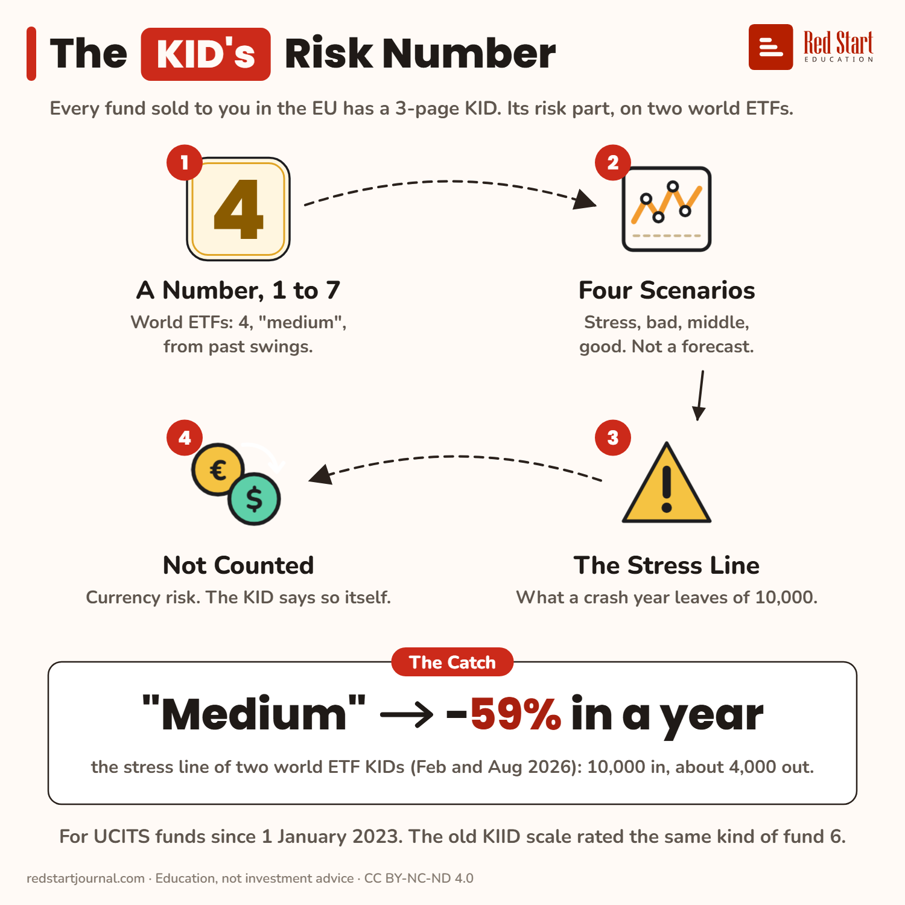

# The KID's Risk Number

Two world ETF KIDs say risk 4 of 7, "medium". Their stress line turns 10,000 into about 4,000 in a year.

## What the sheet says

The KID's Risk Number.
Every fund sold to you in the EU has a 3-page KID. Its risk part, on two world ETFs.

1. A Number, 1 to 7: world ETFs: 4, "medium", from past swings.
2. Four Scenarios: stress, bad, middle, good. Not a forecast.
3. The Stress Line: what a crash year leaves of 10,000.
4. Not Counted: currency risk. The KID says so itself.

The catch: "medium" → −59% in a year: the stress line of two world ETF KIDs (Feb and Aug 2026): 10,000 in, about 4,000 out.
For UCITS funds since 1 January 2023. The old KIID scale rated the same kind of fund 6.

## Sources

1. [KID, State Street SPDR MSCI World UCITS ETF (Acc), IE00BFY0GT14](https://www.ssga.com/library-content/kids?isin=IE00BFY0GT14&documentType=kid&country=it&language=en_gb&ticker=sppw-gy): accurate as of 19 Feb 2026: "4 out of 7, which is a medium risk category", 5-year holding period; stress scenario after 1 year 4,080 USD (−59.2%) from 10,000 USD; scenarios from the worst, average and best performance over the last 10 years; currency risk "is not considered in the indicator". Named here only. Checked 2026-11-02.
2. [KID, Invesco MSCI World UCITS ETF Acc, IE00B60SX394](https://www.invesco.com/content/dam/invesco/emea/en/product-documents/etf/share-class/kid/IE00B60SX394_kid_en.pdf): accurate as at 21 Aug 2026: "4 out of 7, which is a medium risk class"; stress after 1 year 4,030 USD (−59.73%); currency risk "is not considered in the indicator shown above". Named here only. Checked 2026-11-02.
3. [Key Investor Information, iShares Core MSCI World UCITS ETF, IE00B4L5Y983](https://www.ishares.com/gls-download/literature/kiid/ucits_kiid-ishares-core-msci-world-ucits-etf-gb-ie00b4l5y983-en.pdf): BlackRock (UK KIID), 9 Feb 2026: "The Share Class is rated six" on the old 1 to 7 KIID scale. Named here only. Checked 2026-11-02.

---

From [Red Start Journal](https://education.redstartjournal.com/cheat-sheets/the-kid-risk-number) · CC BY-NC-ND 4.0 · Education, not investment advice.
