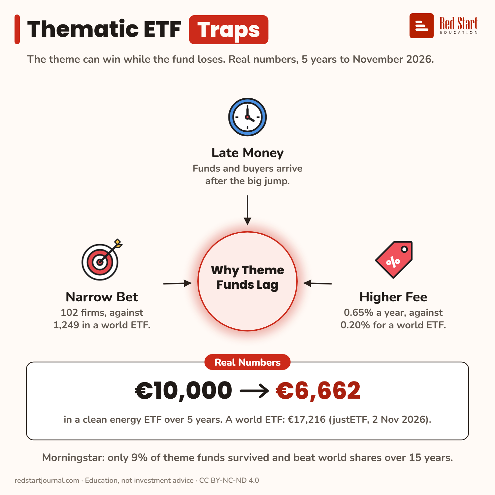

# Thematic ETF Traps

€10,000 in a clean energy ETF became €6,662 in 5 years; in a world ETF, €17,216. The theme can win while the fund loses.

## What the sheet says

Thematic ETF Traps.
The theme can win while the fund loses. Real numbers, 5 years to November 2026.

In the centre: why theme funds lag.
Late Money: funds and buyers arrive after the big jump.
Higher Fee: 0.65% a year, against 0.20% for a world ETF.
Narrow Bet: 102 firms, against 1,249 in a world ETF.

Real numbers: €10,000 → €6,662 in a clean energy ETF over 5 years. A world ETF: €17,216 (justETF, 2 Nov 2026).
Morningstar: only 9% of theme funds survived and beat world shares over 15 years.

## Sources

1. [iShares Global Clean Energy Transition UCITS ETF, IE00B1XNHC34](https://www.justetf.com/en/etf-profile.html?isin=IE00B1XNHC34): justETF, read 2 Nov 2026: 5-year return −33.38%, TER 0.65%, 102 holdings, index S&P Global Clean Energy Transition; calendar years 2022 +0.46%, 2023 −23.24%, 2024 −21.47%, 2025 +29.16%. Named here only. Checked 2026-11-02.
2. [iShares Core MSCI World UCITS ETF, IE00B4L5Y983](https://www.justetf.com/en/etf-profile.html?isin=IE00B4L5Y983): justETF, read 2 Nov 2026: 5-year return +72.16%, TER 0.20%, 1,249 holdings. Checked 2026-11-02.

---

From [Red Start Journal](https://education.redstartjournal.com/cheat-sheets/thematic-etf-traps) · CC BY-NC-ND 4.0 · Education, not investment advice.
