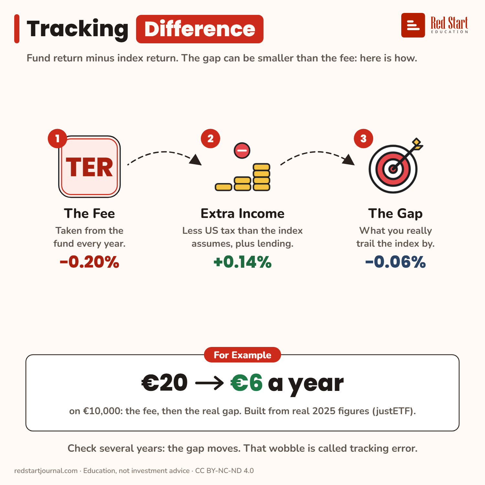

# Tracking Difference

The gap between fund and index can be smaller than the fee: a 0.20% TER minus a 0.14% tax edge leaves a gap of about 0.06%.

## What the sheet says

Tracking Difference.
Fund return minus index return. The gap can be smaller than the fee: here is how.

1. The Fee: taken from the fund every year. −0.20%.
2. Extra Income: less US tax than the index assumes, plus lending. +0.14%.
3. The Gap: what you really trail the index by. −0.06%.

For example: €20 → €6 a year on €10,000: the fee, then the real gap. Built from real 2025 figures (justETF).
Check several years: the gap moves. That wobble is called tracking error.

## Sources

1. [Cost of ETFs: TER vs TCO](https://www.justetf.com/en/news/etf/cost-of-etfs-total-expense-ratio-ter-vs-total-cost-of-ownership-tco.html): justETF, 7 July 2023: tracking difference is the gap between the ETF's and the index's return; securities lending income or a more favourable tax treatment than the index assumes can narrow it. Checked 2026-11-02.
2. [Why synthetic ETFs have the edge in US-dominated markets](https://www.justetf.com/en/academy/synthetic-etfs-in-us-dominated-markets.html): justETF, 9 July 2025: MSCI World yield 1.28% × US 71.5% × 15% ≈ 0.14% a year (the US tax an Irish fund pays). Checked 2026-11-02.
3. [Tracking-Differenz vs. Tracking-Error](https://www.justetf.com/ch/academy/tracking-difference-vs-tracking-error.html): justETF: tracking error is the standard deviation of the gap. Checked 2026-11-02.

---

From [Red Start Journal](https://education.redstartjournal.com/cheat-sheets/tracking-difference) · CC BY-NC-ND 4.0 · Education, not investment advice.
