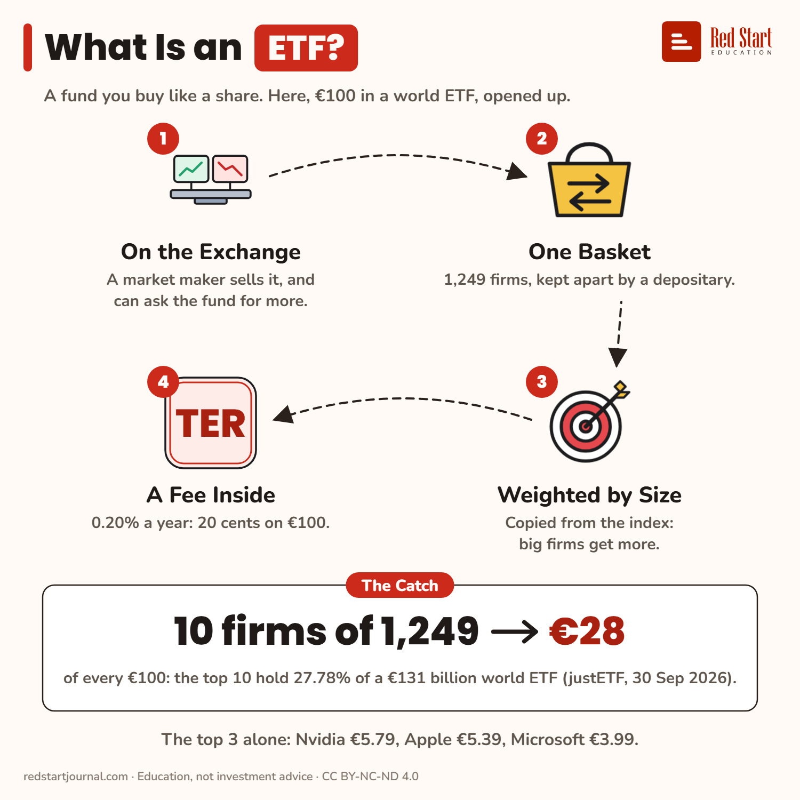

# What Is an ETF?

A fund you buy like a share. €100 in a world ETF, opened up: 1,249 firms, but €28 of it sits in just 10.

## What the sheet says

What Is an ETF?
A fund you buy like a share. Here, €100 in a world ETF, opened up.

1. On the Exchange: a market maker sells it, and can ask the fund for more.
2. One Basket: 1,249 firms, kept apart by a depositary.
3. Weighted by Size: copied from the index: big firms get more.
4. A Fee Inside: 0.20% a year: 20 cents on €100.

The catch: 10 firms of 1,249 → €28 of every €100: the top 10 hold 27.78% of a €131 billion world ETF (justETF, 30 Sep 2026).
The top 3 alone: Nvidia €5.79, Apple €5.39, Microsoft €3.99.

## Sources

1. [iShares Core MSCI World UCITS ETF USD (Acc), IE00B4L5Y983](https://www.justetf.com/en/etf-profile.html?isin=IE00B4L5Y983): justETF, read 2 Nov 2026: 1,249 holdings, top 10 = 27.78%, Nvidia 5.79%, Apple 5.39%, Microsoft 3.99% (holdings as of 30/09/2026); TER 0.20%; fund size EUR 131,264 m. Named here only. Checked 2026-11-02.
2. [Key Investor Information, same fund](https://www.ishares.com/gls-download/literature/kiid/ucits_kiid-ishares-core-msci-world-ucits-etf-gb-ie00b4l5y983-en.pdf): BlackRock, accurate as at 9 Feb 2026: in normal circumstances only authorised participants deal directly with the fund, other investors trade on stock exchanges; the depositary is State Street Custodial Services (Ireland) Limited; the index is weighted by free-float market capitalisation. Checked 2026-11-02.
3. [KID, State Street SPDR MSCI World UCITS ETF](https://www.ssga.com/library-content/kids?isin=IE00BFY0GT14&documentType=kid&country=it&language=en_gb&ticker=sppw-gy): 19 Feb 2026: the fund generally issues and redeems shares only with certain institutional investors; market prices may be above or below the daily NAV. Checked 2026-11-02.

---

From [Red Start Journal](https://education.redstartjournal.com/cheat-sheets/what-is-an-etf) · CC BY-NC-ND 4.0 · Education, not investment advice.
