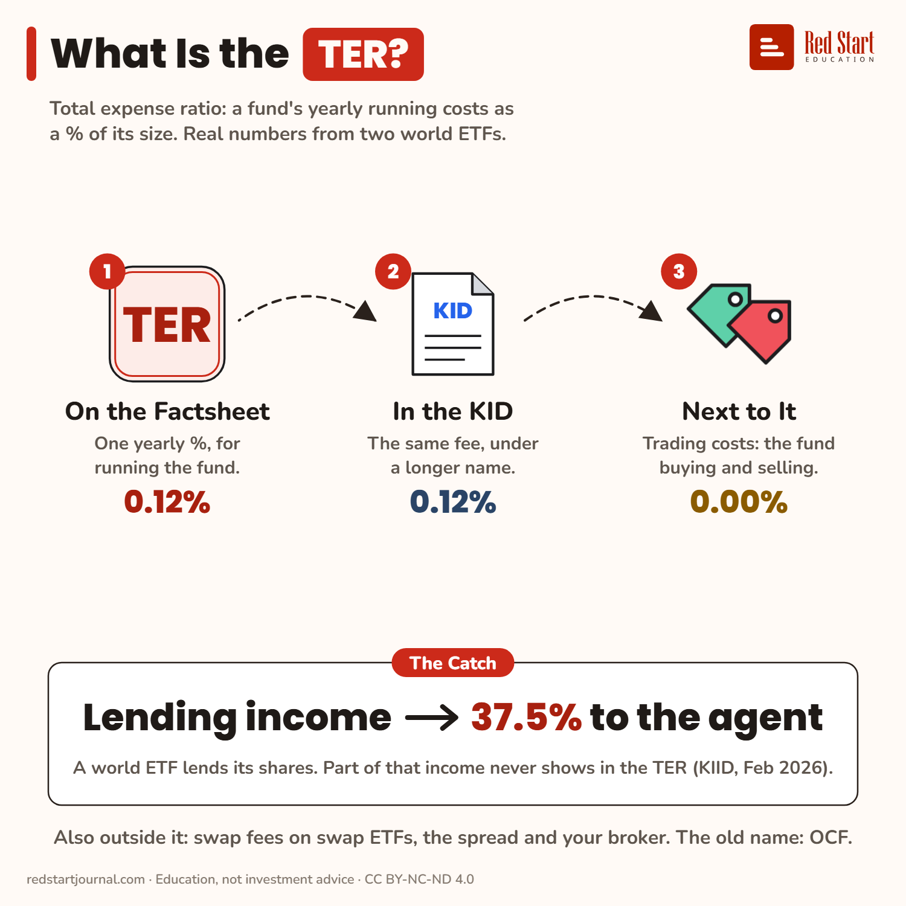

# What Is the TER?

The TER is a fund's yearly running cost as a %. It has three names on three papers, and some money never shows in it.

## What the sheet says

What Is the TER?
Total expense ratio: a fund's yearly running costs as a % of its size. Real numbers from two world ETFs.

1. On the Factsheet: one yearly %, for running the fund. 0.12%.
2. In the KID: the same fee, under a longer name. 0.12%.
3. Next to It: trading costs: the fund buying and selling. 0.00%.

The catch: lending income → 37.5% to the agent. A world ETF lends its shares. Part of that income never shows in the TER (KIID, Feb 2026).
Also outside it: swap fees on swap ETFs, the spread and your broker. The old name: OCF.

## Sources

1. [State Street SPDR MSCI World UCITS ETF (Acc), IE00BFY0GT14](https://www.justetf.com/en/etf-profile.html?isin=IE00BFY0GT14): justETF, read 2 Nov 2026: TER 0.12% p.a., securities lending yes. Named here only. Checked 2026-11-02.
2. [KID, same fund](https://www.ssga.com/library-content/kids?isin=IE00BFY0GT14&documentType=kid&country=it&language=en_gb&ticker=sppw-gy): accurate as of 19 Feb 2026: "Management fees and other administrative or operating costs" 0.12% a year; "Transaction costs" 0.00%; no entry or exit costs, no performance fee. Checked 2026-11-02.
3. [Key Investor Information, iShares Core MSCI World UCITS ETF, IE00B4L5Y983](https://www.ishares.com/gls-download/literature/kiid/ucits_kiid-ishares-core-msci-world-ucits-etf-gb-ie00b4l5y983-en.pdf): BlackRock, 9 Feb 2026: "ongoing charges" 0.20%, based on a fixed annualised fee, excluding portfolio trade related costs; from securities lending the fund receives 62.5% of the revenue and BlackRock, as lending agent, 37.5%; this sharing is excluded from the ongoing charges. Named here only. Checked 2026-11-02.
4. [Swap ETFs: synthetic replication of ETFs](https://www.justetf.com/en/academy/synthetic-replication-of-etfs.html): justETF (Dominique Riedl): "the swap fees are not included in the total expense ratio (TER)". Checked 2026-11-02.
5. [Cost of ETFs: TER vs TCO](https://www.justetf.com/en/news/etf/cost-of-etfs-total-expense-ratio-ter-vs-total-cost-of-ownership-tco.html): justETF, 7 July 2023: the TER is the yearly running costs as a share of the fund's assets and leaves out transaction costs. CESR/10-674 (2010) set the "ongoing charges" figure (OCF) for the UCITS KIID (as in "TER vs What You Really Pay"). Checked 2026-11-02.

---

From [Red Start Journal](https://education.redstartjournal.com/cheat-sheets/what-is-the-ter) · CC BY-NC-ND 4.0 · Education, not investment advice.
