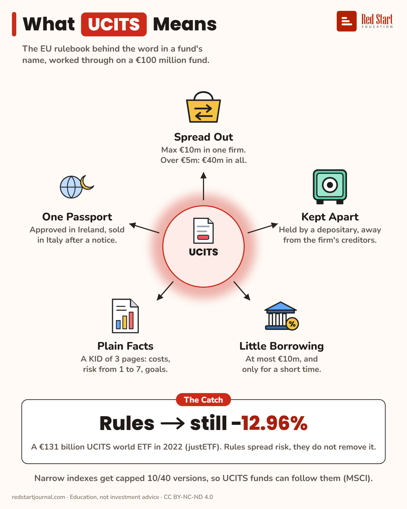

# What UCITS Means

The EU fund rulebook on a €100 million fund. It spreads risk but does not remove it: a UCITS world ETF fell 12.96% in 2022.

## What the sheet says

What UCITS Means.
The EU rulebook behind the word in a fund's name, worked through on a €100 million fund.

In the centre: UCITS.
Spread Out: max €10m in one firm. Over €5m: €40m in all.
Kept Apart: held by a depositary, away from the firm's creditors.
Little Borrowing: at most €10m, and only for a short time.
Plain Facts: a KID of 3 pages: costs, risk from 1 to 7, goals.
One Passport: approved in Ireland, sold in Italy after a notice.

The catch: rules, still −12.96%. A €131 billion UCITS world ETF in 2022 (justETF). Rules spread risk, they do not remove it.
Narrow indexes get capped 10/40 versions, so UCITS funds can follow them (MSCI).

## Sources

1. [UCITS Directive, Article 52](https://www.esma.europa.eu/publications-and-data/interactive-single-rulebook/ucits/article-52): ESMA single rulebook (Directive 2009/65/EC): 5% per issuer, which a Member State may raise to 10%, with the holdings above 5% together at most 40%. Checked 2026-11-02.
2. [Article 22](https://www.esma.europa.eu/publications-and-data/interactive-single-rulebook/ucits/article-22): segregated accounts in the fund's name; assets in custody cannot be used for the depositary's creditors on insolvency. Checked 2026-11-02.
3. [Article 83](https://www.esma.europa.eu/publications-and-data/interactive-single-rulebook/ucits/article-83): temporary borrowing of at most 10% of assets, where allowed. [Article 91](https://www.esma.europa.eu/publications-and-data/interactive-single-rulebook/ucits/article-91): marketing in other Member States after notification. Checked 2026-11-02.
4. [iShares Core MSCI World UCITS ETF, IE00B4L5Y983](https://www.justetf.com/en/etf-profile.html?isin=IE00B4L5Y983): justETF, read 2 Nov 2026: 2022 return −12.96%; fund size EUR 131,264 m. Named here only. Checked 2026-11-02.
5. [MSCI 10/40 Equity Indices](https://www.msci.com/eqb/custom/1040_main.html): and [MSCI Capped Indexes Methodology](https://www.msci.com/indexes/documents/methodology/3_MSCI_Capped_Indexes_Methodology_20240521.pdf): indexes capped at 10% per group entity and 40% for those above 5%, for funds under UCITS limits (launched 2002). Checked 2026-11-02.

---

From [Red Start Journal](https://education.redstartjournal.com/cheat-sheets/what-ucits-means) · CC BY-NC-ND 4.0 · Education, not investment advice.
