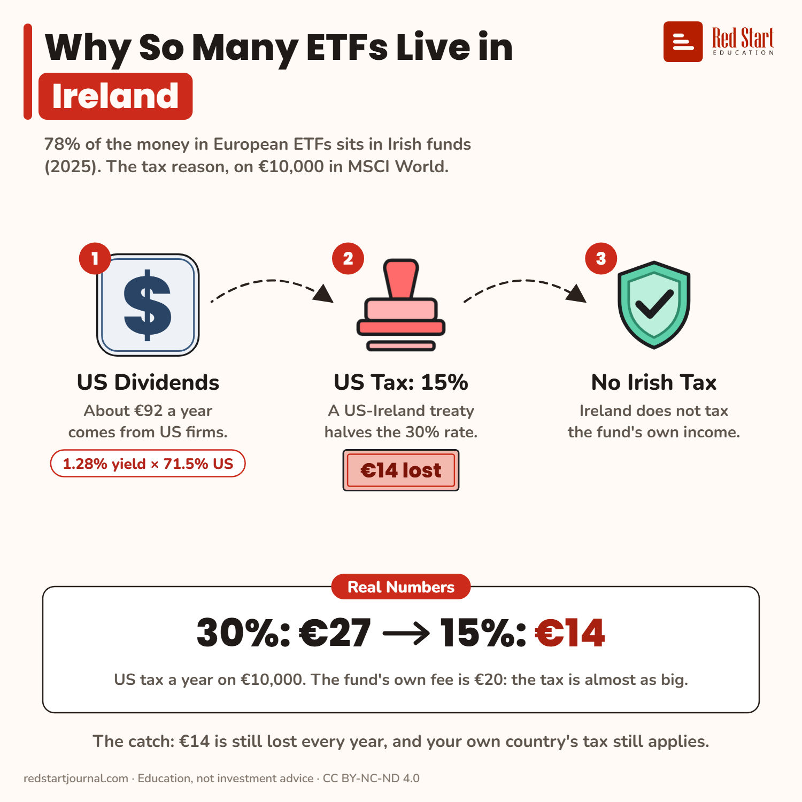

# Why So Many ETFs Live in Ireland

On €10,000 in MSCI World, US tax takes €27 a year at 30% but €14 in an Irish fund: almost as much as a €20 fee.

## What the sheet says

Why So Many ETFs Live in Ireland.
78% of the money in European ETFs sits in Irish funds (2025). The tax reason, on €10,000 in MSCI World.

1. US Dividends: about €92 a year comes from US firms. 1.28% yield × 71.5% US.
2. US Tax: 15%. A US-Ireland treaty halves the 30% rate. €14 lost.
3. No Irish Tax: Ireland does not tax the fund's own income.

Real numbers: 30%: €27, 15%: €14. US tax a year on €10,000. The fund's own fee is €20: the tax is almost as big.
The catch: €14 is still lost every year, and your own country's tax still applies.

## Sources

1. [Ireland Extends Its Dominance in the European ETF Market](https://www.irishfunds.ie/news-knowledge/news/ireland-extends-its-dominance-in-the-european-etf-market-driven-by-active-etfs-commanding-a-96-market-share/): Irish Funds (data ETFBook), 21 November 2025: 78% of European ETF assets, about €1.8 trillion. Checked 2026-11-02.
2. [Why synthetic ETFs have the edge in US-dominated markets](https://www.justetf.com/en/academy/synthetic-etfs-in-us-dominated-markets.html): justETF, 9 July 2025 (data to 30 June 2025): MSCI World 12-month dividend yield 1.28%, US allocation 71.5%; US withholding 30% standard, 15% for Irish funds; drag about 0.14% a year. Checked 2026-11-02.
3. [S.I. No. 425/1999](https://www.irishstatutebook.ie/1999/en/si/0425.html): (US-Ireland treaty, Article 10: 15% on portfolio dividends) and [Euronews, 21 Feb 2025](https://www.euronews.com/business/2025/02/21/amundi-moves-etf-from-luxembourg-to-ireland-due-to-favourable-tax-rule): Irish ETFs pay 15% on US dividends, Luxembourg ones 30%. Checked 2026-11-02.
4. [Revenue: collective investment vehicles](https://revenue.ie/en/companies-and-charities/financial-services/collective-investment-vehicles/funds.aspx): Irish regulated funds are generally exempt from tax on their profits; tax applies at investor level. Checked 2026-11-02.

---

From [Red Start Journal](https://education.redstartjournal.com/cheat-sheets/why-so-many-etfs-live-in-ireland) · CC BY-NC-ND 4.0 · Education, not investment advice.
