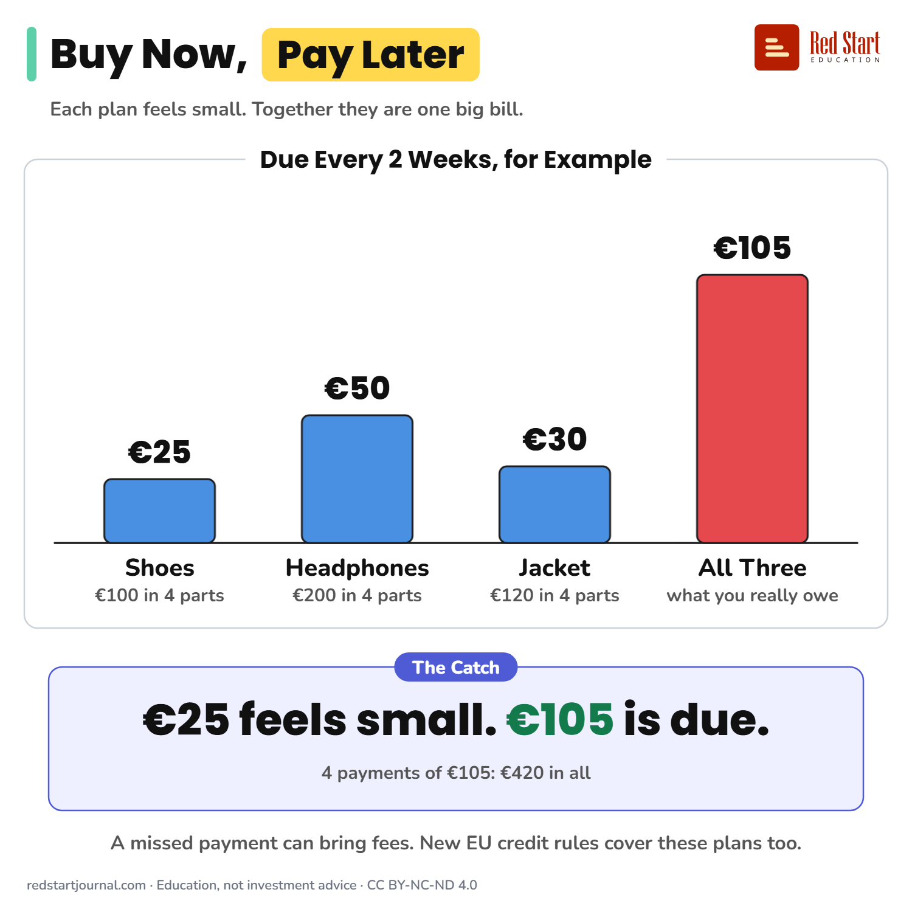

# Buy Now, Pay Later

Buy now, pay later splits a price into small parts that feel free until one is late. EU rules treat it as credit from 20 November 2026.

## What the sheet says

Buy Now, Pay Later.
Each plan feels small. Together they are one big bill.

Due every 2 weeks, for example:
Shoes: €100 in 4 parts, €25.
Headphones: €200 in 4 parts, €50.
Jacket: €120 in 4 parts, €30.
All three: what you really owe, €105.

The catch: €25 feels small, but €105 is due every two weeks: 4 payments, €420 in all.
A missed payment can bring fees. New EU credit rules cover these plans too.

## Sources

1. [Buy Now, Pay Later: Opportunities and Risks of BNPL](https://economiapertutti.bancaditalia.it/notizie-e-rubriche/notizie/buy-now-pay-later-opportunities-and-risks-of-bnpl/): Banca d'Italia (L'economia per tutti), 16 July 2026: part of the price paid up front, the rest in instalments, usually without interest; missed payments bring late fees; several plans can add up to over-indebtedness; Directive (EU) 2023/2225 brings BNPL under consumer credit rules; in Italy expected no earlier than November 2026. Checked 2026-10-29.
2. [Directive (EU) 2023/2225 on credit agreements for consumers](https://eur-lex.europa.eu/eli/dir/2023/2225/oj/eng): European Parliament and Council, 2023: transposition by 20 November 2025, rules apply from 20 November 2026; recital 16 includes interest-free buy now, pay later schemes in scope. Confirmed through the law-firm summaries below, as the EUR-Lex text did not load in our tools. Checked 2026-10-29.
3. [EU Second Consumer Credit Directive: scope and impact for BNPL providers](https://www.hlc.com/en/publications/eu-second-consumer-credit-directive-scope-and-impact-for-buy-now-pay-later-bnpl-providers): HLC, undated: rules apply from 20 November 2026; old Directive 2008/48/EC repealed on that date; a seller's own interest-free deferred payment is exempt only within 50 days (14 days for non-SME sellers and online stores), and third-party BNPL providers are not exempt. Checked 2026-10-29.
4. [CCD2 Explained: BNPL Rules From 20 Nov 2026, by Country](https://briqpay.com/blog/ccd2-explained-eu-consumer-credit-directive-bnpl-country-by-country): Briqpay (payments company), 2026: national start dates differ; Germany, Austria, Denmark, Finland and Sweden apply it from 20 November 2026, the Netherlands had no date set. A private source. Checked 2026-10-29.

---

From [Red Start Journal](https://education.redstartjournal.com/cheat-sheets/buy-now-pay-later) · CC BY-NC-ND 4.0 · Education, not investment advice.
