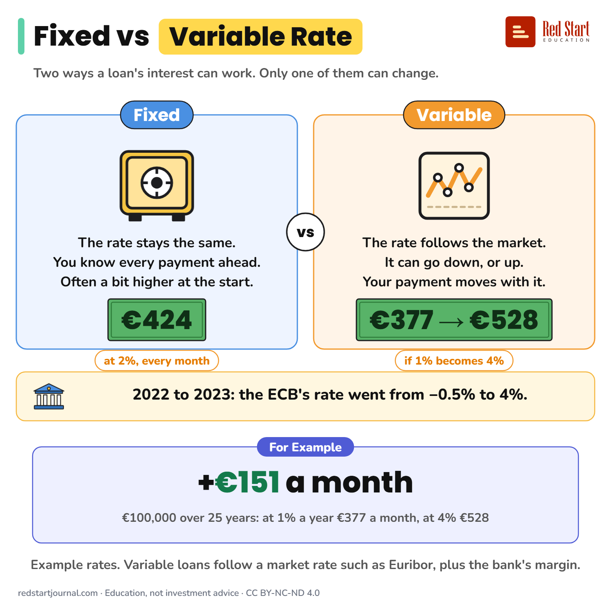

# Fixed vs Variable Rate

A fixed rate keeps every payment the same; a variable rate moves with the market. For example €377 a month can become €528.

## What the sheet says

Fixed vs Variable Rate.
Two ways a loan's interest can work. Only one of them can change.

Fixed: the rate stays the same. You know every payment ahead. Often a bit higher at the start. €424 every month at 2%.
Variable: the rate follows the market. It can go down, or up. Your payment moves with it. €377 can become €528 if 1% becomes 4%.
2022 to 2023: the ECB's rate went from −0.5% to 4%.

For example: +€151 a month. €100,000 over 25 years: at 1% a year €377 a month, at 4% €528.
Example rates. Variable loans follow a market rate such as Euribor, plus the bank's margin.

## Sources

1. [Key ECB interest rates](https://www.ecb.europa.eu/stats/policy_and_exchange_rates/key_ecb_interest_rates/html/index.en.html): European Central Bank, current table: the deposit facility rate was −0.50% until 27 July 2022 and reached 4.00% on 20 September 2023. Checked 2026-10-30.

---

From [Red Start Journal](https://education.redstartjournal.com/cheat-sheets/fixed-vs-variable-rate) · CC BY-NC-ND 4.0 · Education, not investment advice.
