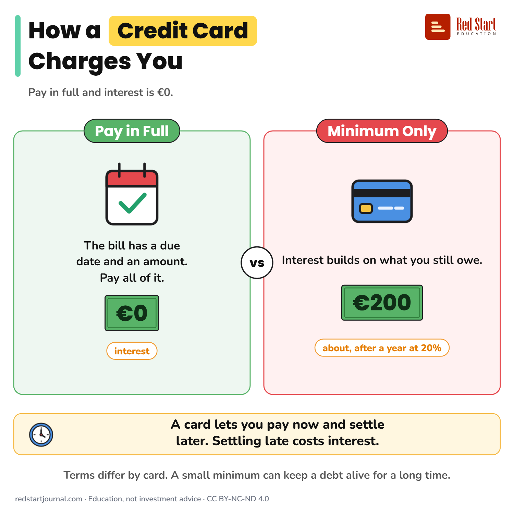

# How a Credit Card Charges You

Pay the card bill in full and interest is €0. Pay only part and interest builds on what you still owe.

## What the sheet says

Title: How a Credit Card Charges You
Highlight: Credit Card
Subtitle: Pay in full and interest is €0.
Frame title: A €1,000 Card Bill, for Example

Part 1: Pay in Full. The bill has a due date and an amount. Pay all of it. €0 (interest).
Part 2: Minimum Only. Interest builds on what you still owe. €200 (about, after a year at 20%).

Verdict: A card lets you pay now and settle later. Settling late costs interest.
Note: Terms differ by card. A small minimum can keep a debt alive for a long time.

Footer: redstartjournal.com · Education, not investment advice · CC BY-NC-ND 4.0

## Sources

1. [Credit card](https://economiapertutti.bancaditalia.it/aree-tematiche/pagamenti/carta-di-credito/index.html): Banca d'Italia (L'economia per tutti), undated page: paying the monthly spend in full has no revolving loan; paying in instalments is an extra loan with interest on the amount still owed, often higher than other forms of credit. Checked 2026-10-29.
2. [Consumer credit made easy](https://www.bancaditalia.it/pubblicazioni/guide-bi/guida-credito-consumatori/Consumer-credit_Made-easy.pdf): Banca d'Italia, undated guide: a low minimum instalment can stretch the length of a debt. Checked 2026-10-29.

---

From [Red Start Journal](https://education.redstartjournal.com/cheat-sheets/how-a-credit-card-charges-you) · CC BY-NC-ND 4.0 · Education, not investment advice.
