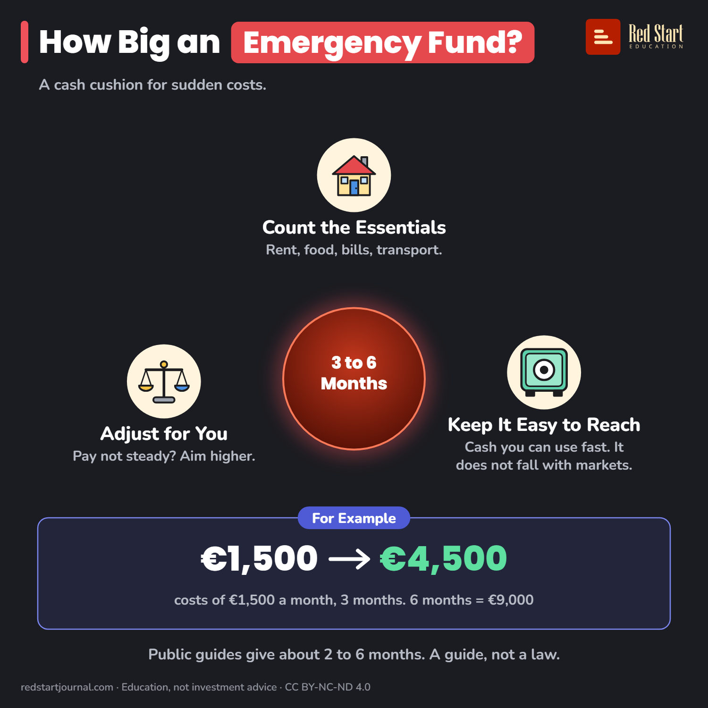

# How Big an Emergency Fund?

A common range is 3 to 6 months of your costs, in cash you can reach fast. For example €4,500 to €9,000 on €1,500 a month.

## What the sheet says

Title: How Big an Emergency Fund?
Highlight: Emergency Fund?
Subtitle: A cash cushion for sudden costs.
Centre: 3 to 6 Months

Part 1: Count the Essentials. Rent, food, bills, transport.
Part 2: Keep It Easy to Reach. Cash you can use fast. It does not fall with markets.
Part 3: Adjust for You. Pay not steady? Aim higher.

Example: For Example. €1,500 → €4,500 costs of €1,500 a month, 3 months. 6 months = €9,000.
Note: Public guides give about 2 to 6 months. A guide, not a law.

Footer: redstartjournal.com · Education, not investment advice · CC BY-NC-ND 4.0

## Sources

1. [L'épargne de précaution : indispensable pour les imprévus avec la Banque de France](https://www.inc-conso.fr/content/lepargne-de-precaution-indispensable-pour-les-imprevus-avec-la-banque-de-france): Institut national de la consommation (France, public consumer body), 24 June 2024: precautionary savings of about 2 to 6 months of income, kept available quickly and safe from capital loss. Checked 2026-10-29.
2. [Comment se constituer une épargne de précaution ?](https://www.lanef.com/blog/epargne-de-precaution/): La Nef (French ethical bank), undated blog: 3 to 6 months of current spending, no exact amount. A private source; used only for the "3 to 6" wording. Checked 2026-10-29.
3. [Épargne de précaution : combien de mois de dépenses prévoir ?](https://www.florish.fr/dynamisation-epargne/articles/epargne-precaution-combien): Florish (French finance site), undated: self-employed or irregular income often aim for more. A private source. Checked 2026-10-29.

---

From [Red Start Journal](https://education.redstartjournal.com/cheat-sheets/how-big-an-emergency-fund) · CC BY-NC-ND 4.0 · Education, not investment advice.
