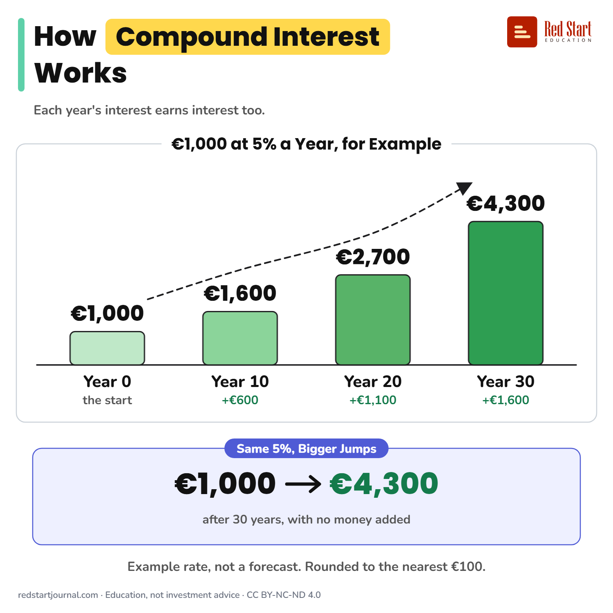

# How Compound Interest Works

Each year's interest earns interest too. For example €1,000 at 5% a year grows to about €1,600 in 10 years and €4,300 in 30.

## What the sheet says

Title: How Compound Interest Works
Highlight: Compound Interest
Subtitle: Each year's interest earns interest too.
Frame title: €1,000 at 5% a Year, for Example

Part 1: Year 0. the start. €1,000.
Part 2: Year 10. +€600. €1,600.
Part 3: Year 20. +€1,100. €2,700.
Part 4: Year 30. +€1,600. €4,300.

Example: Same 5%, Bigger Jumps. €1,000 → €4,300 after 30 years, with no money added.
Note: Example rate, not a forecast. Rounded to the nearest €100.

Footer: redstartjournal.com · Education, not investment advice · CC BY-NC-ND 4.0

## Sources

1. [Interest calculator](https://economiapertutti.bancaditalia.it/strumenti/calcolatori/interest-calculator/): Banca d'Italia (L'economia per tutti), undated: compound interest is reinvested at the same rate, so it earns further interest and can raise the value over time. Checked 2026-10-29.

---

From [Red Start Journal](https://education.redstartjournal.com/cheat-sheets/how-compound-interest-works) · CC BY-NC-ND 4.0 · Education, not investment advice.
