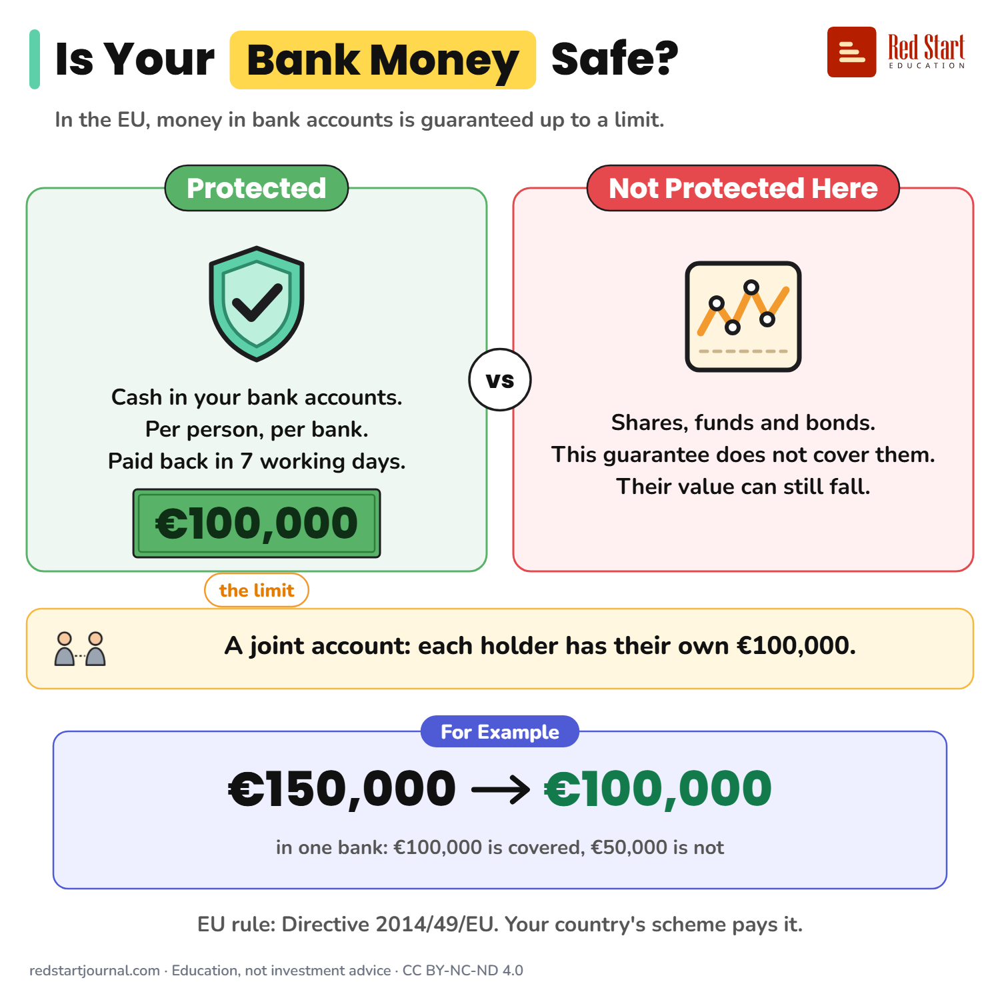

# Is Your Bank Money Safe?

In the EU, deposits are guaranteed up to €!100,000 per person, per bank, paid back in 7 working days. Shares and funds are not deposits.

## What the sheet says

Is Your Bank Money Safe?
In the EU, money in bank accounts is guaranteed up to a limit.

Protected: cash in your bank accounts. Per person, per bank. Paid back in 7 working days. The limit: €!100,000.
Not protected here: shares, funds and bonds. This guarantee does not cover them. Their value can still fall.
A joint account: each holder has their own €!100,000.

For example: €!150,000 in one bank: €!100,000 is covered, €!50,000 is not.
EU rule: Directive 2014/49/EU. Your country's scheme pays it.

## Sources

1. [Directive 2014/49/EU on deposit guarantee schemes](https://eur-lex.europa.eu/eli/dir/2014/49/oj/eng): European Parliament and Council, 2014: harmonised cover of €!100,000 per depositor, per bank; repayment within 7 working days (the deadline fell step by step and reached 7 working days on 1 January 2024); temporary higher cover for sums from private home sales. Checked 2026-10-29.
2. [I have savings and other bank accounts: what are my guarantees?](https://www.garantiedesdepots.fr/en/discover-my-guarantees/I-have-savings-and-other-bank-accounts-what-are-my-guarantees): FGDR (France's national scheme), undated: accounts at one bank added up to €!100,000 per customer; each co-holder's share of a joint account counts toward their own limit; securities, shares and funds are not covered by the deposit guarantee; paid within seven working days. Checked 2026-10-29.
3. [Investor compensation schemes](https://finance.ec.europa.eu/capital-markets-union-and-financial-markets/financial-markets/securities-markets/investor-compensation-schemes_en): European Commission, current page: a separate EU rule (Directive 97/9/EC) pays at least €20,000 per investor if an investment firm fails to return the investor's assets; it does not cover investment risk, such as shares that fall in value. Not on the sheet; it shows what protects shares and funds held at a firm, and what does not. Checked 2026-11-02.

---

From [Red Start Journal](https://education.redstartjournal.com/cheat-sheets/is-your-bank-money-safe) · CC BY-NC-ND 4.0 · Education, not investment advice.
