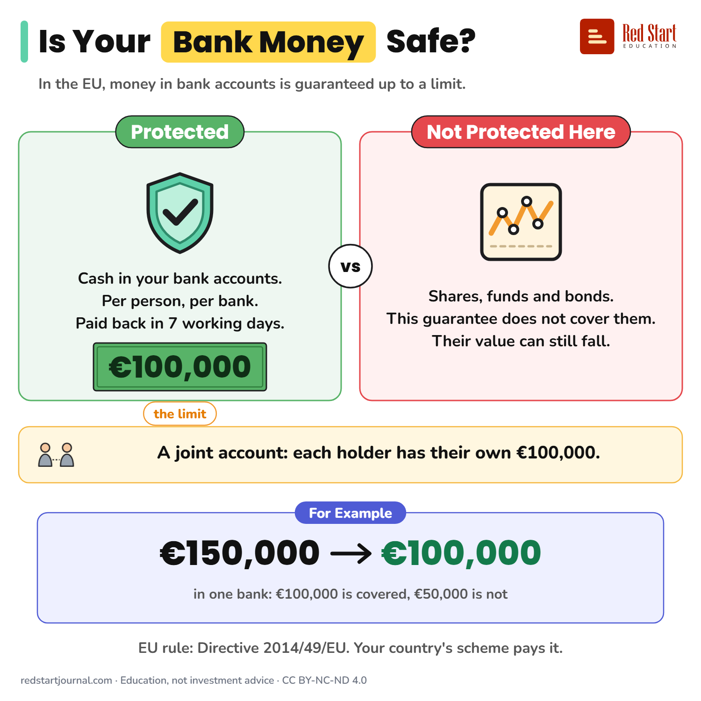

# Is Your Bank Money Safe?

In the EU, deposits are guaranteed up to €100,000 per person, per bank, paid back in 7 working days. Shares and funds are not deposits.

## What the sheet says

Is Your Bank Money Safe?
In the EU, money in bank accounts is guaranteed up to a limit.

Protected: cash in your bank accounts. Per person, per bank. Paid back in 7 working days. The limit: €100,000.
Not protected here: shares, funds and bonds. This guarantee does not cover them. Their value can still fall.
A joint account: each holder has their own €100,000.

For example: €150,000 in one bank: €100,000 is covered, €50,000 is not.
EU rule: Directive 2014/49/EU. Your country's scheme pays it.

## Sources

1. [Directive 2014/49/EU on deposit guarantee schemes](https://eur-lex.europa.eu/eli/dir/2014/49/oj/eng): European Parliament and Council, 2014: harmonised cover of €100,000 per depositor, per bank; repayment within 7 working days (the deadline fell step by step and reached 7 working days on 1 January 2024); temporary higher cover for sums from private home sales. Checked 2026-10-29.
2. [I have savings and other bank accounts: what are my guarantees?](https://www.garantiedesdepots.fr/en/discover-my-guarantees/I-have-savings-and-other-bank-accounts-what-are-my-guarantees): FGDR (France's national scheme), undated: accounts at one bank added up to €100,000 per customer; each co-holder's share of a joint account counts toward their own limit; securities, shares and funds are not covered by the deposit guarantee; paid within seven working days. Checked 2026-10-29.

---

From [Red Start Journal](https://education.redstartjournal.com/cheat-sheets/is-your-bank-money-safe) · CC BY-NC-ND 4.0 · Education, not investment advice.
