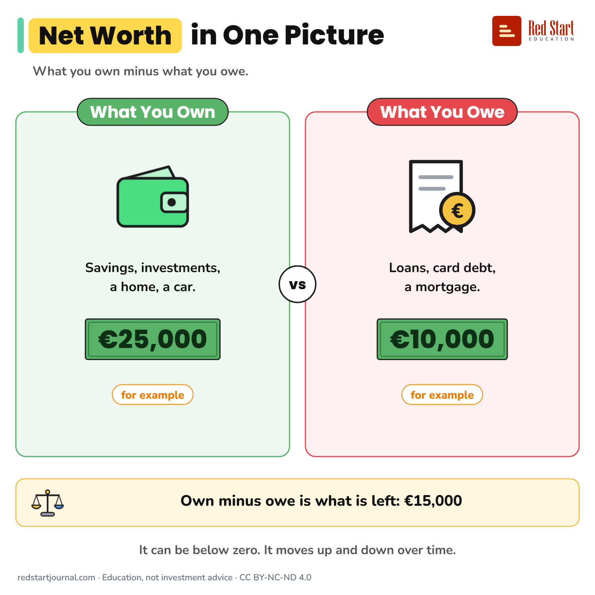

# Net Worth in One Picture

Net worth is what you own minus what you owe. For example €25,000 owned minus €10,000 owed is €15,000.

## What the sheet says

Title: Net Worth in One Picture
Highlight: Net Worth
Subtitle: What you own minus what you owe.

Part 1: What You Own. Savings, investments, a home, a car. €25,000 (for example).
Part 2: What You Owe. Loans, card debt, a mortgage. €10,000 (for example).

Verdict: Own minus owe is what is left: €15,000
Note: It can be below zero. It moves up and down over time.

Footer: redstartjournal.com · Education, not investment advice · CC BY-NC-ND 4.0

## Sources

1. [The Household Finance and Consumption Survey, Wave 2021, Statistical tables](https://www.ecb.europa.eu/home/pdf/research/hfcn/HFCS_Statistical_Tables_Wave_2021_July2023.pdf): European Central Bank, 2023: net wealth is total assets minus total liabilities; assets include the home, other property, vehicles and financial assets; liabilities include mortgages, other loans, credit lines and credit card debt. Checked 2026-10-29.

---

From [Red Start Journal](https://education.redstartjournal.com/cheat-sheets/net-worth-in-one-picture) · CC BY-NC-ND 4.0 · Education, not investment advice.
