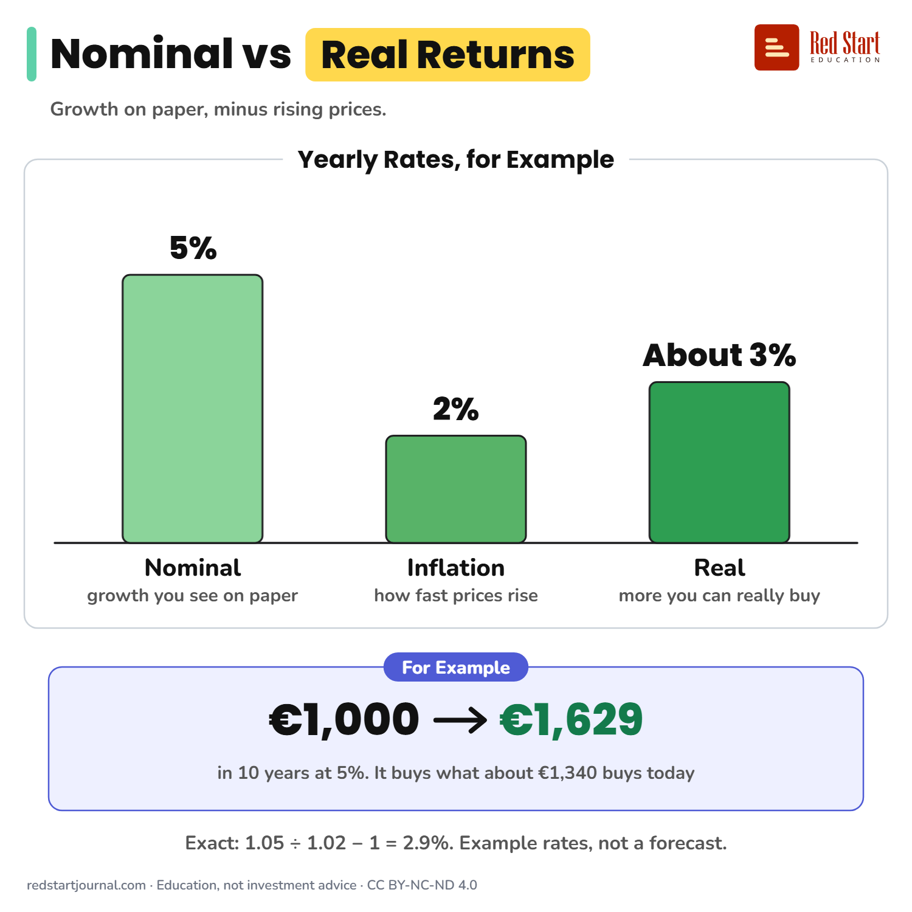

# Nominal vs Real Returns

Nominal return is the growth on paper. Real return is that growth minus rising prices: 5% growth with 2% inflation is about 3% real.

## What the sheet says

Title: Nominal vs Real Returns
Highlight: Real Returns
Subtitle: Growth on paper, minus rising prices.
Frame title: Yearly Rates, for Example

Part 1: Nominal. growth you see on paper. 5%.
Part 2: Inflation. how fast prices rise. 2%.
Part 3: Real. more you can really buy. About 3%.

Example: For Example. €1,000 → €1,629 in 10 years at 5%. It buys what about €1,340 buys today.
Note: Exact: 1.05 ÷ 1.02 − 1 = 2.9%. Example rates, not a forecast.

Footer: redstartjournal.com · Education, not investment advice · CC BY-NC-ND 4.0

## Sources

1. [Two per cent inflation target](https://www.ecb.europa.eu/mopo/strategy/pricestab/html/index.en.html): European Central Bank, undated page: the ECB's 2% medium-term inflation target, the source of the "2%" in the example. Checked 2026-10-29.

---

From [Red Start Journal](https://education.redstartjournal.com/cheat-sheets/nominal-vs-real-returns) · CC BY-NC-ND 4.0 · Education, not investment advice.
