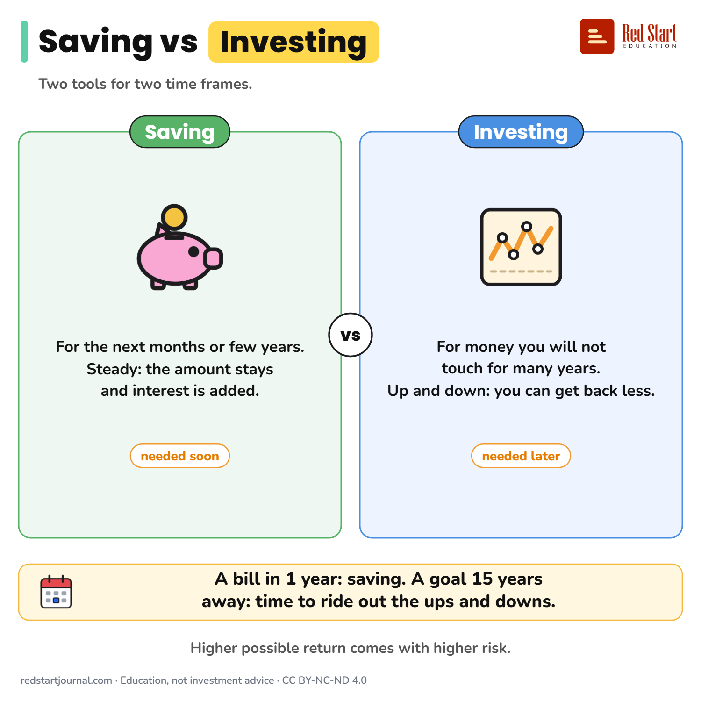

# Saving vs Investing

Saving is for money you need soon and want steady. Investing is for later, and its value goes up and down.

## What the sheet says

Title: Saving vs Investing
Highlight: Investing
Subtitle: Two tools for two time frames.

Part 1: Saving. For the next months or few years. Steady: the amount stays and interest is added. (needed soon).
Part 2: Investing. For money you will not touch for many years. Up and down: you can get back less. (needed later).

Verdict: A bill in 1 year: saving. A goal 15 years away: time to ride out the ups and downs.
Note: Higher possible return comes with higher risk.

Footer: redstartjournal.com · Education, not investment advice · CC BY-NC-ND 4.0

## Sources

1. [Before investing](https://economiapertutti.bancaditalia.it/aree-tematiche/risparmio-e-investimenti/introduzione-agli-investimenti/index.html): Banca d'Italia (L'economia per tutti), undated page: higher returns come with higher risk; for a short time frame choose low risk, a longer time frame can carry more risk; low-risk examples include savings deposits. Checked 2026-10-29.
2. [Savings and investments (quiz)](https://economiapertutti.bancaditalia.it/strumenti/giochi/quiz/savings-and-investments/): Banca d'Italia (L'economia per tutti), undated: the link between risk and return is called the basic rule of investing. Checked 2026-10-29.

---

From [Red Start Journal](https://education.redstartjournal.com/cheat-sheets/saving-vs-investing) · CC BY-NC-ND 4.0 · Education, not investment advice.
