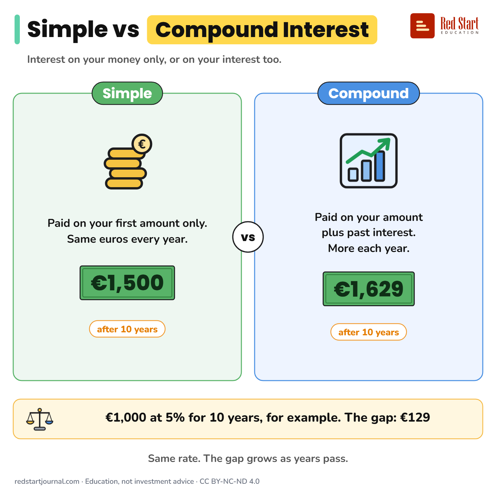

# Simple vs Compound Interest

Simple interest is paid on your money only. Compound interest is paid on your interest too. For example €1,000 at 5% for 10 years.

## What the sheet says

Title: Simple vs Compound Interest
Highlight: Compound Interest
Subtitle: Interest on your money only, or on your interest too.

Part 1: Simple. Paid on your first amount only. Same euros every year. €1,500 (after 10 years).
Part 2: Compound. Paid on your amount plus past interest. More each year. €1,629 (after 10 years).

Verdict: €1,000 at 5% for 10 years, for example. The gap: €129
Note: Same rate. The gap grows as years pass.

Footer: redstartjournal.com · Education, not investment advice · CC BY-NC-ND 4.0

## Sources

1. [Interest calculator](https://economiapertutti.bancaditalia.it/strumenti/calcolatori/interest-calculator/): Banca d'Italia (L'economia per tutti), undated: simple interest is not reinvested, compound interest is reinvested at the same rate so it earns further interest. Checked 2026-10-29.

---

From [Red Start Journal](https://education.redstartjournal.com/cheat-sheets/simple-vs-compound-interest) · CC BY-NC-ND 4.0 · Education, not investment advice.
