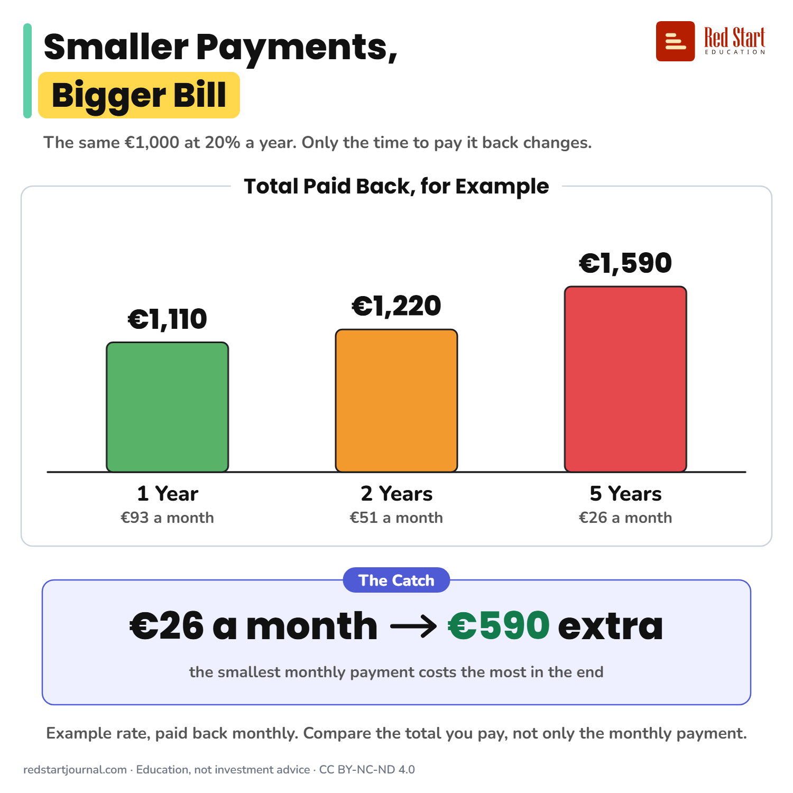

# Smaller Payments, Bigger Bill

The same €1,000 at 20% a year costs about €1,110 over 1 year and €1,590 over 5. The smallest monthly payment costs the most.

## What the sheet says

Smaller Payments, Bigger Bill.
The same €1,000 at 20% a year. Only the time to pay it back changes.

Total paid back, for example:
1 year: €93 a month, about €1,110 in all.
2 years: €51 a month, about €1,220 in all.
5 years: €26 a month, about €1,590 in all.

The catch: €26 a month means about €590 extra. The smallest monthly payment costs the most in the end.
Example rate, paid back monthly. Compare the total you pay, not only the monthly payment.

## Sources

1. [Consumer credit made easy](https://www.bancaditalia.it/pubblicazioni/guide-bi/guida-credito-consumatori/Consumer-credit_Made-easy.pdf): Banca d'Italia, undated guide: compare loans by their annual cost (the APR, called TAEG in Italy), which includes interest and charges. Checked 2026-10-29.

---

From [Red Start Journal](https://education.redstartjournal.com/cheat-sheets/smaller-payments-bigger-bill) · CC BY-NC-ND 4.0 · Education, not investment advice.
