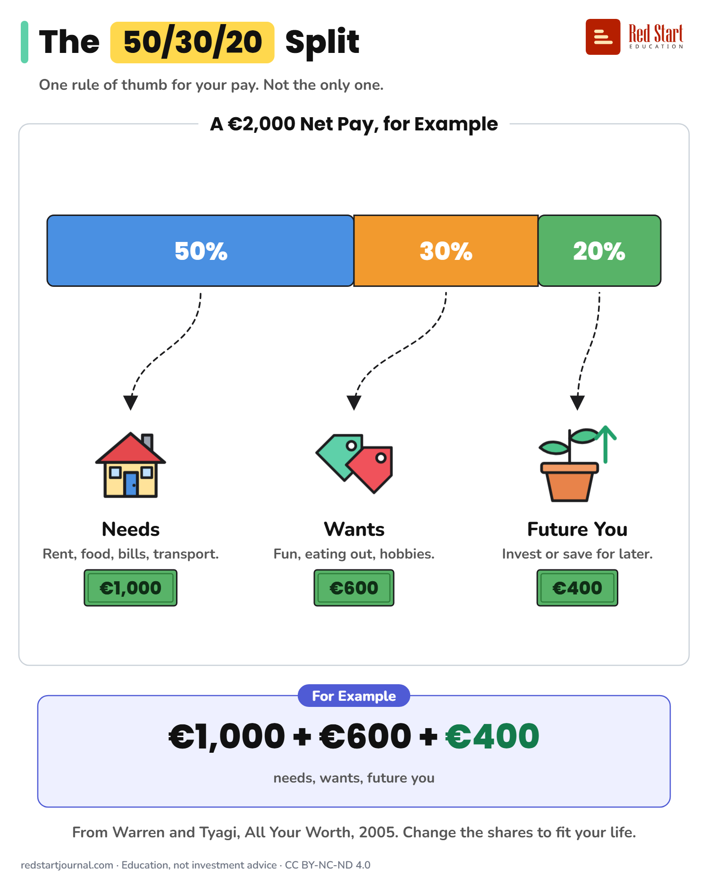

# The 50/30/20 Split

One rule of thumb to split pay: 50% needs, 30% wants, 20% for your future. For example, on €2,000 net pay. It is not the only way.

## What the sheet says

Title: The 50/30/20 Split
Highlight: 50/30/20
Subtitle: One rule of thumb for your pay. Not the only one.
Frame title: A €2,000 Net Pay, for Example

Part 1: Needs. Rent, food, bills, transport. €1,000. 50%.
Part 2: Wants. Fun, eating out, hobbies. €600. 30%.
Part 3: Future You. Invest or save for later. €400. 20%.

Example: For Example. €1,000 + €600 + €400 needs, wants, future you.
Note: From Warren and Tyagi, All Your Worth, 2005. Change the shares to fit your life.

Footer: redstartjournal.com · Education, not investment advice · CC BY-NC-ND 4.0

## Sources

1. [All Your Worth: The Ultimate Lifetime Money Plan](https://books.google.com/books/about/All_Your_Worth.html?id=IfGaD4FKm04C): Elizabeth Warren and Amelia Warren Tyagi, Free Press / Simon and Schuster, 2005 (listing on Google Books): the origin of the 50/30/20 rule. The book calls the 50% group "must-haves"; we say "needs". Checked 2026-10-29.
2. [Financial planning](https://economiapertutti.bancaditalia.it/aree-tematiche/risparmio-e-investimenti/la-pianificazione/index.html): Banca d'Italia (L'economia per tutti), undated page: separate needs from wants and set savings goals; shows that budget splits are a planning aid, not a fixed rule. Checked 2026-10-29.

---

From [Red Start Journal](https://education.redstartjournal.com/cheat-sheets/the-50-30-20-split) · CC BY-NC-ND 4.0 · Education, not investment advice.
