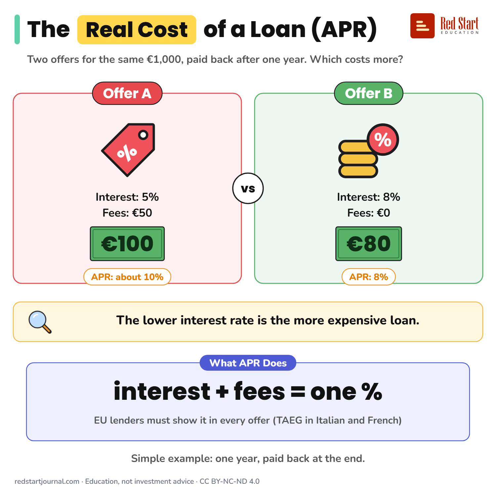

# The Real Cost of a Loan (APR)

The APR is one yearly percentage that includes interest and fees. EU lenders must show it before you sign.

## What the sheet says

The Real Cost of a Loan (APR).
Two offers for the same €1,000, paid back after one year. Which costs more?

Offer A: interest 5%, fees €50. Total cost €100. APR about 10%.
Offer B: interest 8%, fees €0. Total cost €80. APR 8%.
The lower interest rate is the more expensive loan.

What APR does: interest and fees, as one yearly %. EU lenders must show it in every offer (TAEG in Italian and French).
Simple example: one year, paid back at the end.

## Sources

1. [Directive 2008/48/EC on credit agreements for consumers](https://eur-lex.europa.eu/legal-content/EN/ALL/?uri=CELEX%3A32008L0048): European Parliament and Council, 2008: the annual percentage rate of charge is the total cost of credit as a yearly percentage of the credit amount, and must be stated in the pre-contract information and in the credit agreement. Checked 2026-10-29.
2. [Directive (EU) 2023/2225 on credit agreements for consumers](https://eur-lex.europa.eu/eli/dir/2023/2225/oj/eng): European Parliament and Council, 2023: replaces Directive 2008/48/EC; member states had to adopt rules by 20 November 2025 and apply them from 20 November 2026. Dates confirmed through law-firm summaries (the EUR-Lex text did not load in our tools): [EU Second Consumer Credit Directive: scope and impact for BNPL providers](https://www.hlc.com/en/publications/eu-second-consumer-credit-directive-scope-and-impact-for-buy-now-pay-later-bnpl-providers), HLC, undated (apply 20 November 2026; old directive repealed on that date). Checked 2026-10-29.
3. [Der "TAEG" bei Krediten: Was ist das?](https://www.consumer.bz.it/de/der-taeg-bei-krediten-was-ist-das): Verbraucherzentrale Südtirol, December 2022: TAEG (Tasso Annuo Effettivo Globale) is "der effektive Jahreszins"; it includes processing fees, insurance the lender requires, taxes and other contract costs; default interest is not included. Checked 2026-10-29.
4. [Crédit : à quoi correspond le taux annuel effectif global (TAEG) ?](https://www.economie.gouv.fr/particuliers/emprunter-et-sassurer/credit-quoi-correspond-le-taux-annuel-effectif-global-taeg): French Ministry of the Economy, undated: the French name TAEG, taux annuel effectif global. Checked 2026-10-29.

---

From [Red Start Journal](https://education.redstartjournal.com/cheat-sheets/the-real-cost-of-a-loan-apr) · CC BY-NC-ND 4.0 · Education, not investment advice.
