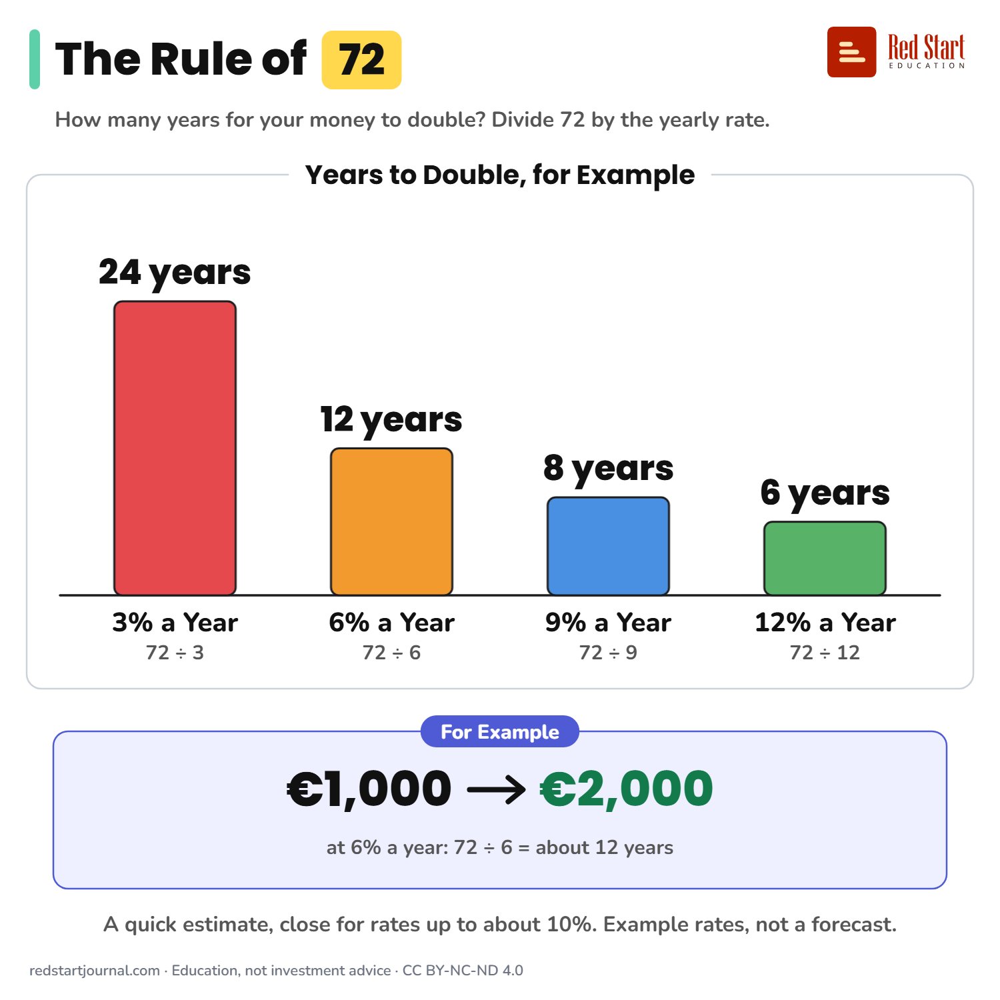

# The Rule of 72

Divide 72 by the yearly rate to estimate the years to double your money. At 6% that is about 12 years. It is an estimate.

## What the sheet says

The Rule of 72.
How many years for your money to double? Divide 72 by the yearly rate.

Years to double, for example:
3% a year: 72 ÷ 3 = 24 years.
6% a year: 72 ÷ 6 = 12 years.
9% a year: 72 ÷ 9 = 8 years.
12% a year: 72 ÷ 12 = 6 years.

For example: €1,000 becomes about €2,000 in about 12 years at 6% a year.
A quick estimate, close for rates up to about 10%. Example rates, not a forecast.

## Sources

1. [Doubling Your Money With the "Rule of 72"](https://ndbf.nebraska.gov/doubling-your-money-rule-72): Nebraska Department of Banking and Finance (a US state regulator), undated: divide 72 by the expected annual return to get the years to double. A US page, used only for the plain description of the rule. Checked 2026-10-29.

---

From [Red Start Journal](https://education.redstartjournal.com/cheat-sheets/the-rule-of-72) · CC BY-NC-ND 4.0 · Education, not investment advice.
