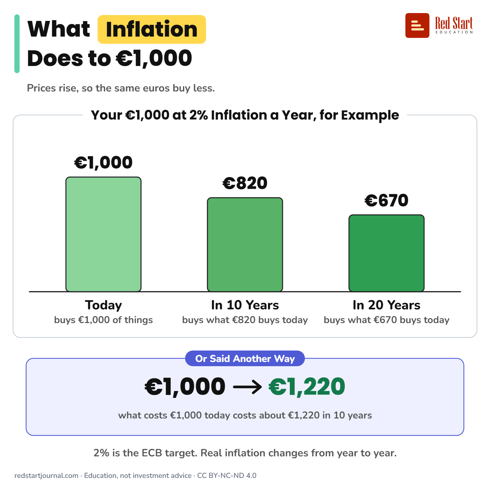

# What Inflation Does to €1,000

At 2% inflation a year, €1,000 kept for 10 years buys what about €820 buys today. 2% is the ECB's target for the euro area.

## What the sheet says

Title: What Inflation Does to €1,000
Highlight: Inflation
Subtitle: Prices rise, so the same euros buy less.
Frame title: Your €1,000 at 2% Inflation a Year, for Example

Part 1: Today. buys €1,000 of things. €1,000.
Part 2: In 10 Years. buys what €820 buys today. €820.
Part 3: In 20 Years. buys what €670 buys today. €670.

Example: Or Said Another Way. €1,000 → €1,220 what costs €1,000 today costs about €1,220 in 10 years.
Note: 2% is the ECB target. Real inflation changes from year to year.

Footer: redstartjournal.com · Education, not investment advice · CC BY-NC-ND 4.0

## Sources

1. [Two per cent inflation target](https://www.ecb.europa.eu/mopo/strategy/pricestab/html/index.en.html): European Central Bank, undated page: the ECB's target is 2% inflation over the medium term, adopted in July 2021, measured with the HICP for the euro area. Checked 2026-10-29.

---

From [Red Start Journal](https://education.redstartjournal.com/cheat-sheets/what-inflation-does-to-1000-euros) · CC BY-NC-ND 4.0 · Education, not investment advice.
