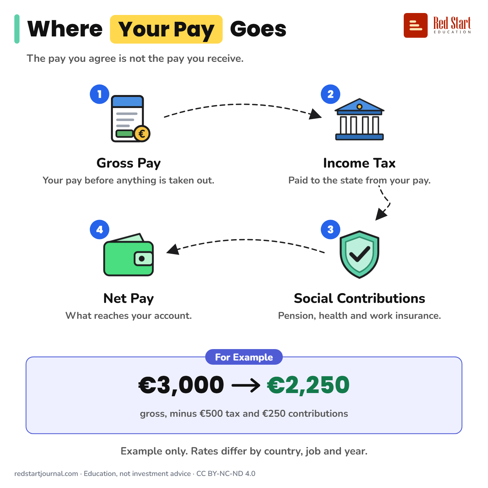

# Where Your Pay Goes

Gross pay minus income tax and social contributions is your net pay, the money that reaches your account. One example, no country's rates.

## What the sheet says

Title: Where Your Pay Goes
Highlight: Your Pay
Subtitle: The pay you agree is not the pay you receive.

Part 1: Gross Pay. Your pay before anything is taken out.
Part 2: Income Tax. Paid to the state from your pay.
Part 3: Social Contributions. Pension, health and work insurance.
Part 4: Net Pay. What reaches your account.

Example: For Example. €3,000 → €2,250 gross, minus €500 tax and €250 contributions.
Note: Example only. Rates differ by country, job and year.

Footer: redstartjournal.com · Education, not investment advice · CC BY-NC-ND 4.0

## Sources

1. [Net earnings and tax rates (earn_net)](https://webgate.ec.europa.eu/eurostat/cache/metadata/en/earn_net_esms.htm): Eurostat, undated metadata page: net earnings are gross earnings minus the employee's social security contributions and income tax (family allowances may be added). Checked 2026-10-29.
2. [Glossary: Earnings](https://ec.europa.eu/eurostat/statistics-explained/index.php/Glossary:Earnings): Eurostat Statistics Explained, undated: gross and net earnings defined. Checked 2026-10-29.

---

From [Red Start Journal](https://education.redstartjournal.com/cheat-sheets/where-your-pay-goes) · CC BY-NC-ND 4.0 · Education, not investment advice.
