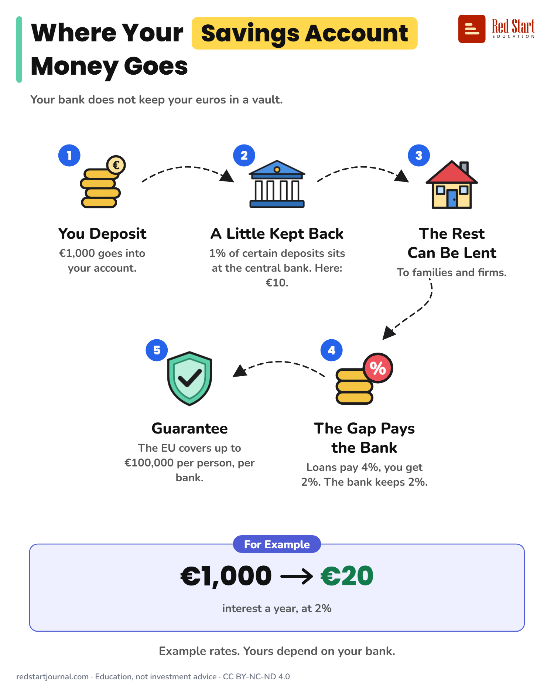

# Where Your Savings Account Money Goes

Your bank keeps a small part at the central bank, uses the rest for loans, and pays you part of what the loans earn. Example rates.

## What the sheet says

Title: Where Your Savings Account Money Goes
Highlight: Savings Account
Subtitle: Your bank does not keep your euros in a vault.

Part 1: You Deposit. €1,000 goes into your account.
Part 2: A Little Kept Back. 1% of certain deposits sits at the central bank. Here: €10.
Part 3: The Rest Can Be Lent. To families and firms.
Part 4: The Gap Pays the Bank. Loans pay 4%, you get 2%. The bank keeps 2%.
Part 5: Guarantee. The EU covers up to €100,000 per person, per bank.

Example: For Example. €1,000 → €20 interest a year, at 2%.
Note: Example rates. Yours depend on your bank.

Footer: redstartjournal.com · Education, not investment advice · CC BY-NC-ND 4.0

## Sources

1. [What are minimum reserve requirements?](https://www.ecb.europa.eu/ecb-and-you/explainers/tell-me/html/minimum_reserve_req.en.html): European Central Bank, 2016, updated 2023: euro area banks hold 1% of specific liabilities, mainly customer deposits and short-term debt, in accounts at their national central bank. Checked 2026-10-29.
2. [Minimum reserves](https://www.bundesbank.de/en/tasks/monetary-policy/minimum-reserves/minimum-reserves-625912): Deutsche Bundesbank, undated: the ratio has been 1% since 18 January 2012. Press reports in mid-2026 say the ECB may consider 2%; no decision found on 2026-10-29, so the sheet says 1%. Checked 2026-10-29.
3. [Directive 2014/49/EU on deposit guarantee schemes](https://eur-lex.europa.eu/eli/dir/2014/49/oj/eng): European Parliament and Council, 2014: €100,000 per depositor, per bank. Checked 2026-10-29.
4. [I have savings and other bank accounts: what are my guarantees?](https://www.garantiedesdepots.fr/en/discover-my-guarantees/I-have-savings-and-other-bank-accounts-what-are-my-guarantees): FGDR (France's national scheme), undated: €100,000 per customer, per bank, paid within seven working days. Checked 2026-10-29.

---

From [Red Start Journal](https://education.redstartjournal.com/cheat-sheets/where-your-savings-account-money-goes) · CC BY-NC-ND 4.0 · Education, not investment advice.
